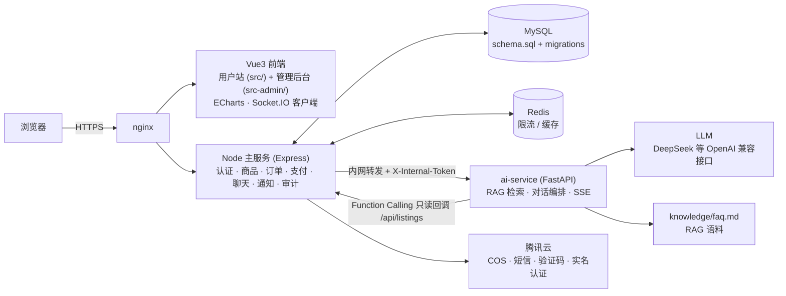

# PlayLease · 游戏账号租赁平台

> 全栈游戏账号租赁平台：Vue3 用户站 + 管理后台、Node/Express 主服务、资金冻结与结算、实时聊天，以及独立的 **AI 助手微服务**（RAG 规则问答 + Function Calling 智能选号，SSE 流式输出）。


## 在线演示

主站 <https://sparks.pub> ｜ 管理后台 <https://admin.sparks.pub>（演示环境，数据可随意操作）

| 角色 | 账号 | 凭据 |
|---|---|---|
| 普通用户 / 卖家 | `18500006601` ~ `18800006604` | 密码 `Demo@123456`，或验证码 `123456` |
| 客服 | `18900006605` | `Demo@123456` |
| 管理员 | `19900006606` | 后台仅验证码 `123456` |

也支持任意手机号现场注册（验证码统一 `123456`）。

## 架构



## 核心功能

**平台（用户站）**
- 账号租赁全流程：商品发布 / 浏览筛选 / 下单 / 支付，订单资金**冻结与结算**（[设计文档](docs/freeze-funds-and-settlement.md)）
- 租家 ⇄ 卖家实时聊天（Socket.IO）、站内通知、客服工单与举报反馈
- AI 助手抽屉式聊天：流式对话、规则问答带引用来源、自然语言智能选号

**管理后台（src-admin/）**
- 商品审核、订单管理、经营数据看板（ECharts）、业务参数配置

**安全与合规**
- JWT + Passkey（WebAuthn）双通道登录，bcrypt 密码散列
- helmet + Redis 分布式限流；腾讯云验证码 / 短信 / FaceID 实名认证
- 独立审计模块记录敏感操作；密钥只存在于服务器环境变量，仓库内仅 `.env.example` 占位

## AI 助手（ai-service/）

独立 Python 微服务，主站不直连公网，由 Node 主服务统一鉴权、限流后经内网 `X-Internal-Token` 转发：

- **RAG**：`knowledge/faq.md` 语料 + 混合检索（字级 bigram TF-IDF，可选向量召回）；语料指纹（md5）变化自动重新向量化，向量结果带缓存；未配置 Embedding 时自动降级为纯词法检索，回答附引用来源
- **Function Calling（Agent）**：`search_listings` / `get_listing_detail` 两个只读工具（不触碰资金），LLM 多轮工具循环完成"帮我找个性价比高的号"
- **SSE 流式协议**：`sources` / `delta` / `tool_call` / `tool_result` / `done` / `error` 六类事件，前端 `fetch + getReader` 解析渲染
- 详细设计见 [ai-service/README.md](ai-service/README.md)

## 快速开始

```bash
# 1. 依赖：本地 MySQL + Redis（可用 deploy/compose/ 下的 compose 文件启动）

# 2. 主服务
cd server && npm install
cp .env.example .env        # 填数据库 / Redis / 腾讯云配置
cd .. && npm run dev:server # http://localhost:3000

# 3. 用户站前端 / 管理后台（根目录）
npm install
npm run dev                 # 用户站  http://localhost:5173
npm run dev:admin           # 管理后台 http://localhost:5174

# 4. AI 助手微服务
cd ai-service
python -m venv .venv && .venv\Scripts\activate
pip install -r requirements.txt
copy .env.example .env      # 填 AI_LLM_API_KEY（必填），Embedding 三项可不填
uvicorn app.main:app --reload --port 8000
```

生产部署采用 Docker Compose + nginx，蓝绿双 api 容器零停机发布，秒级回滚。

## 目录结构

```
├── src/            # 用户站前端（Vue3）
├── src-admin/      # 管理后台前端（Vue3 + ECharts）
├── server/         # Node 主服务（Express，模块化：auth/listing/order/payment/chat/notification/audit…）
├── ai-service/     # AI 助手微服务（FastAPI：RAG + Function Calling + SSE）
├── nginx/          # 站点 nginx 配置
├── deploy/         # 生产部署（compose / mysql / nginx / scripts，蓝绿发布）
└── docs/           # 产品需求文档、开发设计文档、资金冻结与结算设计
```

## 文档

- [产品需求文档](docs/产品需求文档.md)
- [开发设计文档](docs/开发设计文档.md)
- [资金冻结与结算设计](docs/freeze-funds-and-settlement.md)
- [AI 助手服务说明](ai-service/README.md)
