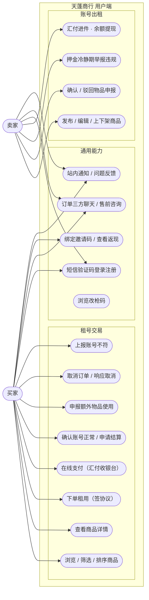
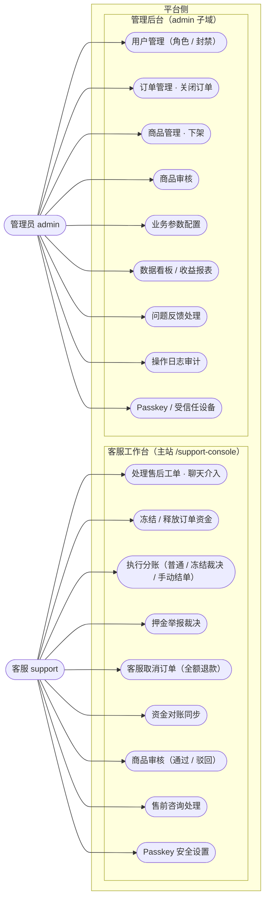
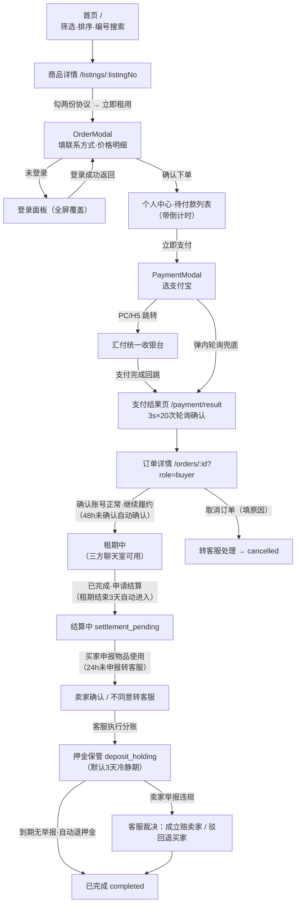
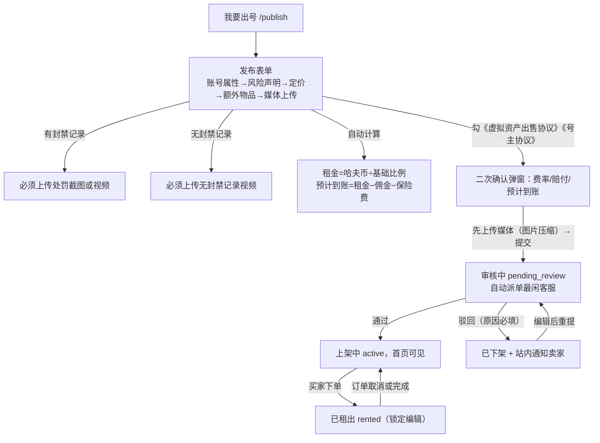
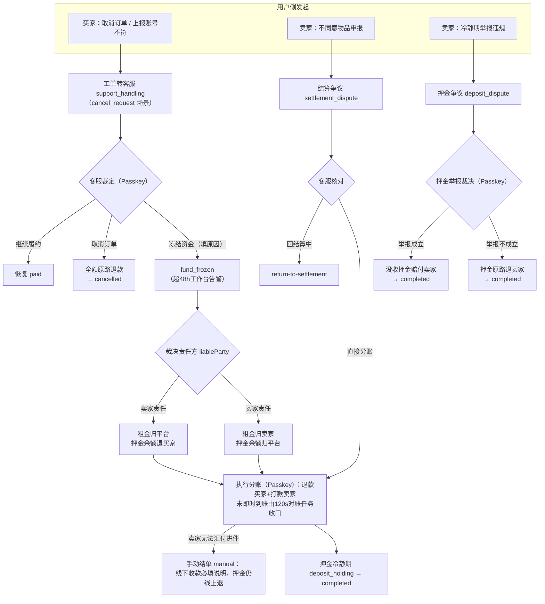
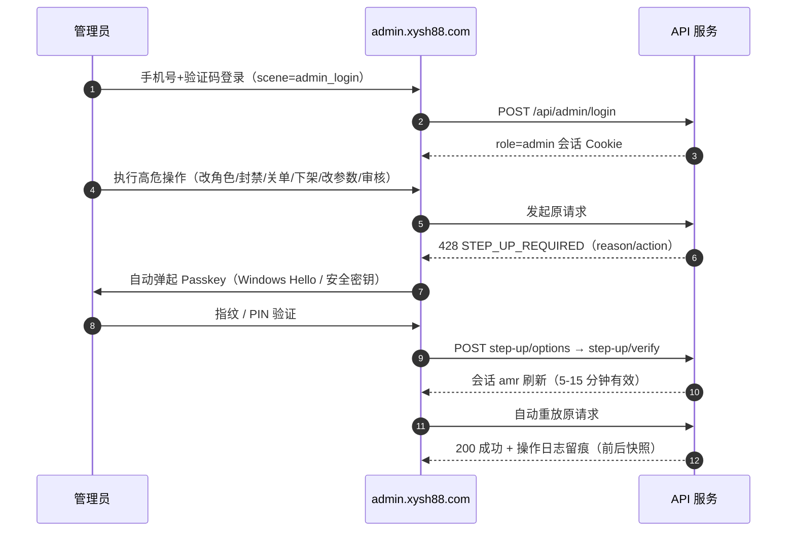

# 天蓬商行（三角洲行动账号租赁平台）产品需求文档

| 项 | 内容 |
| --- | --- |
| 产品名称 | 天蓬商行 —— 三角洲改枪码 / 账号租赁平台 |
| 站点 | `https://xysh88.com`（用户端）· `https://admin.xysh88.com`（管理后台） |
| 运营主体 | 汉中西游星泽网络科技有限公司（陕ICP备2026014619号-1） |
| 文档版本 | v1.0（2026-08-28，按线上实际功能编写） |
| 关联文档 | 《开发设计文档.md》（架构 / 数据库 / 接口 / 流程图） |

---

## 1. 产品概述

### 1.1 产品定位

面向《三角洲行动》（Delta Force）玩家的**游戏账号 C2C 短租平台**：号主（卖家）发布账号出租，玩家（买家）按天租用，平台居间担保交易——**买家资金经汇付天下托管**，履约完成后平台分账（扣佣、退押金余额、打款卖家），纠纷由客服裁决。附带「改枪码」免费分享页作引流内容。

### 1.2 角色定义

| 角色 | 说明 |
| --- | --- |
| 买家 | 租用账号的用户；手机号注册，同一账号可买可卖 |
| 卖家（号主） | 发布账号出租的用户；需完成汇付进件（开户+绑卡）才能线上收款 |
| 客服（support） | 平台员工；主站客服工作台处理售后/售前/商品审核/一切资金强操作 |
| 管理员（admin） | 平台管理；独立后台负责用户/订单/商品/参数/数据看板/审计 |

### 1.3 核心业务模式

1. **资金托管**：买家付款（租金+押金一次支付）进入平台汇付商户账户托管；「冻结」= 平台暂不退款/打款。汇付商户自动结算必须保持关闭。
2. **双边定价**：卖家发布租金 × (1+买家服务费率) 为买家实付价；额外物品卖家定价、买家侧可升价，**差价归平台且双边互不可见对方价格**。
3. **押金冷静期**：结算后押金不立即退，默认保管 3 天，期间卖家可举报买家开挂等违规，客服裁决没收赔付或驳回退回。
4. **客服裁决制**：取消、结算争议、资金冻结、押金举报四类纠纷全部由客服裁决，资金操作强制 Passkey 二次校验。

---

## 2. 用例图

### 2.1 用户侧（买家 / 卖家）

### 2.2 平台侧（客服 / 管理员）

---

## 3. 功能需求与操作项

### 3.1 账号与登录

| 功能点 | 操作项 | 规则 |
| --- | --- | --- |
| 登录/注册一体 | 输入手机号 → 点「获取验证码」（先过腾讯云行为验证）→ 输入短信验证码 → 勾选《用户协议》《隐私政策》→ 登录 | 新手机号自动注册（用户名=掩码手机号）；验证码 60s 倒计时持久化；无密码登录（原密码接口已 410） |
| 绑定邀请码 | 登录面板选填 / 个人中心「邀新赚钱」内填写 | 仅可绑定一次、不可改、不可自绑 |
| 管理员/客服登录 | 后台页或工作台用手机号+验证码 | scene=admin_login 单号日限收紧；非对应角色 403 |
| 退出登录 | 个人中心 → 退出登录（确认弹窗） | 吊销当前会话 |

### 3.2 商品浏览与搜索（游客可浏览）

| 功能点 | 操作项 | 规则 |
| --- | --- | --- |
| 筛选 | 上号时间（昼/夜）、保险等级（2/4/6/9格）、体力、负重、登录方式、刀皮（有/无）、干员外观（多选）、哈夫币/租金/押金区间（档位+自定义）、角色等级区间、道具筛选、地区 | 10 个筛选器；部分选项来自后台业务配置 |
| 排序 | 默认（热度）｜小额专区（哈夫币≤阈值）｜特惠专区（比例≥阈值）｜哈夫币/比例/租金/AWM/六头/六甲 升降序 | 热度=近 7 天独立点击（预聚合表） |
| 搜索 | 商品编号**精确**搜索 | 暂无关键词模糊搜索 |
| 商品卡 | 点卡片进详情、复制编号、分享（关键字段拼文案复制） | 无限滚动 10/页；返回列表还原滚动位置 |
| 商品详情 | 查看属性/物品/图片；点开大图/视频预览；复制编号 | 处罚截图与封禁视频需登录可见；额外物品买家视角按买家侧结算价显示 |
| 点击埋点 | 登录用户点进详情自动上报 | 每会话每商品一次，用于热度 |

### 3.3 商品发布与审核（卖家）

| 功能点 | 操作项 | 规则 |
| --- | --- | --- |
| 发布商品 | 填账号属性（上号方式/时间、保险、体力、负重、潜水、洗消舱）→ 风险声明（封禁记录、人脸归属、等级/段位/KD/地区）→ 定价（哈夫币余额、押金、基础比例、出租天数）→ 额外物品（出售/赠送+数量）→ 上传图片/凭证 → 选保险赔付方案 → 勾两份协议 → 二次确认（展示费率与预计到账）→ 提交 | 押金 100-2000 元；基础比例 35-120；租期上限 30 天；图片 ≤10 张；「有封禁记录」必须上传处罚截图或视频，「无记录」必须上传无封禁视频；提交后进 pending_review 并自动派单最闲客服 |
| 编辑/上下架 | 个人中心「我发布的」→ 编辑 / 下架 / 重新上架 | 编辑后重新进待审；未审通过不可上架；被租出（rented）期间锁定 |
| 审核结果通知 | 驳回后站内通知（含原因） | 驳回商品转已下架，可编辑后重提 |

### 3.4 下单与支付（买家）

| 功能点 | 操作项 | 规则 |
| --- | --- | --- |
| 下单 | 详情页勾《账号租用支付前协议》《租客使用规则与风险告知》→「立即租用」→ OrderModal 填联系方式 → 确认下单 | 未登录引导登录；订单=租金+押金（一次支付）；商品锁定转 rented；生成订单号、进入三方聊天室、自动分配客服 |
| 待付款倒计时 | 订单详情/列表显示倒计时（默认 10 分钟，后台可配） | 超时系统查单后自动关单+取消+商品恢复上架 |
| 支付 | 「立即支付」→ PaymentModal 选支付宝 → 跳汇付收银台（PC 整页 / H5）→ 支付 → 回跳结果页轮询确认 | 同一订单 pending 流水幂等复用；支付结果由回调+查单+超时任务三路兜底 |
| 取消 | 待付款：直接取消；已支付未确认账号：填原因申请取消（转客服） | 确认账号正常后不可直接取消 |
| 确认账号 | 「确认账号正常，继续履约」 | 48h 未确认系统自动确认；确认后可申请结算 |

### 3.5 履约与结算

| 功能点 | 操作项 | 规则 |
| --- | --- | --- |
| 申请结算 | 买家「已完成，申请结算」 | 租期结束 3 天未申请，系统自动进入结算 |
| 物品申报 | 买家填各「出售」物品使用数量（0..N）+备注 | 24h 未申报转客服仲裁；出售物品按买家侧单价从押金扣 |
| 卖家确认 | 卖家「确认表单」/「不同意」（填说明转客服） | 48h 未处理视为确认 |
| 结算预览 | 双方在订单详情看各自金额（平台抽成与对方金额不可见） | 结算执行由客服在工作台完成（Passkey 校验） |
| 押金冷静期 | 买家看保管金额/预计退回时间；到期自动原路退 | 默认 3 天（后台可配，0=立即退）；期间卖家可举报 |

### 3.6 纠纷与资金处置（用户侧入口）

| 用户侧入口 | 动作 | 平台侧处理 |
| --- | --- | --- |
| 买家「取消订单」（已支付）/ 卖家取消申请 | 转客服 cancel_request | 客服裁定：继续履约 / 取消订单（全额退款） |
| 卖家「不同意物品申报」 | 转客服 settlement_dispute | 客服核对后执行分账或退回结算 |
| 买家「上报账号不符」 | 转客服 | 客服调查，可**冻结资金**（填原因）→ 裁决责任方后冻结结算 |
| 卖家「举报买家违规」（冷静期内） | 转客服 deposit_dispute | 裁决：成立=没收押金赔卖家 / 不成立=退买家；超 48h 工作台告警 |

### 3.7 聊天与消息

| 功能点 | 操作项 | 规则 |
| --- | --- | --- |
| 订单三方聊天室 | 订单详情「进入聊天室」→ ConversationPanel | 买家/卖家/客服三方；文本 ≤2000 字；多图上传（≤5MB，压缩）；敏感词过滤（「加微信/转账」等屏蔽）；系统消息样式 |
| 售前咨询 | 首页悬浮球/侧边栏「售前咨询」 | 买家↔客服，自动派单；客服标记完成 |
| 消息中心 | 个人中心「我的消息」：会话+系统通知合并列表、未读红点（全局实时） | 未读汇总分项（售前/售后/通知）；点击通知标记已读 |
| 站内通知 | 审核结果、结算完成、押金退回等系统通知 | Socket 实时推送 + HTTP 兜底 |

### 3.8 邀新返现

| 功能点 | 操作项 | 规则 |
| --- | --- | --- |
| 查看返现 | 「邀新赚钱」：我的邀请码、累计返现、我赚的/TA 赚的明细 | 返现=被邀请人订单的**买家服务费 × 30%**（比例后台可配）；结算时打款，失败暂存钱包 |
| 绑定邀请码 | 登录时或页面内填写 | 一次性 |
| 提现 | 已入驻者跳汇付商户门户 | — |

### 3.9 收款与提现（卖家）

| 功能点 | 操作项 | 规则 |
| --- | --- | --- |
| 汇付进件 | 「收款账号」两步：①个人开户（姓名/身份证/手机号/证件有效期）②绑卡（持卡人/卡号/省市/证件） | 未入驻者在「我发布的」看警示条；执行分账时校验已绑卡，否则引导手动结单 |
| 余额与提现 | 查余额 → 输金额提现（D1 到账） | 单笔上限默认 5 万、每日 5 笔；工作日免手续费、节假日 0.05% |
| 记录查询 | 结算记录（可刷新状态）、取现记录（可查到账状态） | 取现受理≠到账，状态由查单推进 |

### 3.10 问题反馈

| 功能点 | 操作项 | 规则 |
| --- | --- | --- |
| 提交反馈 | 选分类（账号登录/商品信息/订单支付/聊天违规举报/功能建议/其他）+ 描述 | 5-1000 字；每日 1 条（后台可配） |
| 查看记录 | 「问题反馈」我的列表 | 管理员处理（处理中/已解决/驳回+备注） |

### 3.11 客服工作台（support）

| 功能点 | 操作项 | 约束 |
| --- | --- | --- |
| 售后工单台 | 按处理中/已完成+关键词检索；双击开单；查看买卖双方联系方式、流程状态、时间线；聊天介入；内部备注 | 未读实时红点；工作量统计（待跟进/已完成/今日完成/超时提醒）+ **冻结超时（48h）/押金举报超时（48h）告警卡** |
| 资金操作 | 继续履约 / 回结算中 / 取消订单（全额退）/ 冻结资金 / 释放资金 / 执行分账 / 押金举报裁决 / 资金对账同步 | 全部 **Passkey 二次校验**；执行分账前展示结算预览；冻结裁决需选责任方（卖家/买家责任两套公式）；手动结单必填线下收款说明 |
| 售前咨询台 | 检索/进入会话/备注/标记完成 | — |
| 商品审核台 | 待审队列 → 详情三页（属性/物品/凭证媒体）→ 通过（选填备注）/ 驳回（必填原因） | 原子操作防双审；驳回自动通知卖家 |
| 安全设置 | 短信验证 + WebAuthn 注册 Passkey；设备列表删除 | 与后台共用 /api/admin/passkeys 端点 |

### 3.12 管理后台（admin）

| 板块 | 操作项 | 约束 |
| --- | --- | --- |
| 运营概览 | 指标卡、趋势图（日/月/年/自定义）、收益明细表 | 收益=平台抽成汇总+订单明细 |
| 用户管理 | 搜索、改角色（user/support/admin）、封禁（1-3650 天）/解封、客服改名 | 高危操作 Passkey；不能封自己/admin；改角色即时吊销会话 |
| 订单管理 | 搜索/日期筛选、30s 自动刷新、关闭订单 | 已付款关单=原路退款+商品下架；资金在途场景禁用关单 |
| 商品管理 | 搜索（含分页）、下架 | — |
| 商品审核 | 同客服审核台（管理端入口） | 高危操作 Passkey |
| 参数配置 | 三页签：业务规则 / 保险赔付方案 / 额外物品双边定价 | 保存 Passkey；改动写操作日志；前端镜像即时失效更新 |
| 问题反馈 | 状态流转 + 备注 | — |
| 操作日志 | 模块/关键词/日期筛选；查看变更前后快照 | 全部高危动作留痕 |
| 安全设置 | Passkey 管理（绑定需短信）、受信任设备（30 天） | step-up 策略说明 |

---

## 4. 业务规则汇总

### 4.1 定价与佣金

| 规则 | 公式/取值 |
| --- | --- |
| 卖家租金 | 哈夫币余额(M) ÷ 基础比例（比例 35-120，万哈夫币/元） |
| 买家实付租金 | 卖家租金 × (1 + 买家服务费率)，费率默认 10%（后台可配） |
| 平台抽成（普通结算） | floor(卖家租金 × 卖家服务费率) + 额外物品差价（买家价−卖家价，仅买家价更高时） |
| 卖家入账 | max(0, 卖家租金 − 卖家佣金 − 保险费) + 出售物品款（卖家侧价） |
| 保险费 | 按赔付方案：premium 高级 9% / medium 中级 5% / basic 初级 0%（租金抽成） |
| 买家退款（普通结算） | max(0, 押金 − 买家侧物品扣款) |
| 邀新返现 | 买家服务费 × 30%（可配），结算时打款邀请人 |
| 额外物品 | 双边定价：卖家结算价 + 买家结算扣款价；差价归平台；**双方互不可见对方价格**；「赠送」物品不结算 |

### 4.2 冻结裁决公式（资金冻结后按责任方）

| 责任方 | 平台抽成 | 卖家入账 | 买家退款 |
| --- | --- | --- | --- |
| 卖家责任（默认） | 买家实付租金 + 物品差价 | 仅物品款（租金归平台） | max(0, 押金 − 买家侧物品扣款) |
| 买家责任 | max(0, 押金 − 卖家侧物品款) | 买家实付租金 + 物品款 | 0 |

物品款两种裁决下均照常结算给卖家；支持 payout_mode=manual（客服线下收款，强制备注留痕）。

### 4.3 超时与自动规则矩阵（后台可配）

| 场景 | 默认值 | 动作 |
| --- | --- | --- |
| 待付款超时 | 10 分钟 | 查单→未付则汇付关单+订单取消+商品恢复上架 |
| 支付后未确认账号 | 48h | 自动视为已确认（verified_at=paid_at） |
| 租期结束未申请结算 | 3 天 | 自动进入结算中 |
| 买家未申报物品 | 24h | 转客服仲裁 |
| 卖家未确认申报 | 48h | 视为确认 |
| 资金冻结未处理 | 48h | 客服工作台告警 |
| 押金举报未裁决 | 48h（1-720 可配） | 客服工作台告警 |
| 押金冷静期 | 3 天（0=关闭） | 到期自动原路退买家 |
| 取现 | 单笔 ≤5 万、每日 5 笔 | D1 到账 |
| 上传配额 | 100MB/天/用户 | 超限拒绝 |

### 4.4 商品/订单状态联动

- 商品被下单 → `rented`（锁定）；订单取消/完成 → 恢复 `active`；结算完成 → `sold_out`。
- 审核驳回 → 商品 `inactive`，编辑重提后再进 `pending_review`。
- 订单主状态 7 态：`pending_payment → paid → settlement_pending → deposit_holding → completed`，旁路 `support_handling` / 终态 `cancelled`（详见《开发设计文档》4.3）。

---

## 5. 前端交互图

### 5.1 购买主流程（买家动线）

### 5.2 发布商品流程（卖家动线）

### 5.3 售后与资金处置交互（用户 ↔ 客服协同）

### 5.4 管理后台高危操作交互（Passkey 二次校验）

---

## 6. 范围边界与非功能需求

### 6.1 当前版本明确不做 / 未上线

| 项 | 现状 |
| --- | --- |
| 购物车 / 多商品合并下单 | 无，一单一商品 |
| 商品评价体系 | 无 |
| 买家自助退款申请 | 无；退款统一经「取消订单→客服」或结算退款 |
| 商品关键词模糊搜索 | 仅完整商品编号精确搜索 |
| 续租 | 租期固定；归还=申请结算 |
| 代肝板块 | 入口占位，提示「开发中」 |
| 公告 / 站内信管理 | 无管理端模块（站内通知仅系统事件触发） |
| 批量操作 UI | step-up 字典预留 batch_operation，无界面 |
| 提现管理后台 UI | 操作日志预留 wallet 模块，无界面 |
| 微信登录 / 微信支付 | 无集成；微信仅作联系字段与敏感词屏蔽对象 |
| 实名认证 FaceID | 已从主链路移除（卖家走汇付进件实名） |
| 管理端订单列表分页 | 暂无（固定 20 条/页），商品列表已补分页 |

### 6.2 非功能需求摘要

| 类别 | 要求 | 实现（详见《开发设计文档》） |
| --- | --- | --- |
| 性能 | 列表页响应快、读多写少 | Redis 详情缓存 180s、7 日热度预聚合表、复合索引、gzip、静态资源 1 年强缓存、WebP 变体降流量 |
| 可用性 | 发布零停机、支付回调不丢 | 蓝绿双容器 + 健康检查门槛 + 优雅停机；支付结果三路兜底（回调/轮询查单/超时任务）+ 120s 资金对账 |
| 资金安全 | 任何状态不入错账 | 金额一致性校验、状态守卫 UPDATE、reason/remark 幂等键、对账收口、商户自动结算关闭约束 |
| 防刷 | 短信/注册/发布/上传 | 天御验证码前置、双层限流矩阵、日配额、DB 频控计数表 |
| 后台安全 | 高危操作可控 | Passkey 二次校验（428 协议）、IP 白名单（含到期自动收紧）、操作日志全留痕、受信任设备 30 天 |
| 合规 | 备案与协议 | ICP/公网安备、协议版本化（buyer-v1.1.0 / payment-v1.1.0）、聊天敏感词、北京时间统一 |

---

## 附：术语表

| 术语 | 含义 |
| --- | --- |
| 改枪码 | 三角洲行动武器配装分享码（平台免费内容页，引流用） |
| 哈夫币 | 游戏内货币；商品定价锚（余额 M ÷ 基础比例 = 租金） |
| 基础比例 | 万哈夫币/元的换算系数（35-120） |
| 额外物品 | 随账号出租的高级物资（保险卡/子弹/装备），「出售」按使用量从押金扣，「赠送」不结算 |
| 押金冷静期 | 结算后押金保管期（默认 3 天），供卖家举报买家违规 |
| 手动结单 | 卖家无法汇付进件时，客服线下收卖家款，押金仍线上退（payout_mode=manual） |
| 冻结 | 平台将托管资金暂不退不付，待客服裁决（fund_frozen） |
| 进件 | 卖家在汇付开户+绑卡（个人用户开户 / 业务入驻） |
