# 天蓬商行（三角洲行动账号租赁平台）开发设计文档

| 项 | 内容 |
| --- | --- |
| 产品 | 天蓬商行 —— 《三角洲行动》游戏账号 C2C 租赁平台（租号 / 出号 / 平台担保 / 资金托管结算） |
| 站点 | 主站 `https://xysh88.com`，管理后台 `https://admin.xysh88.com` |
| 文档版本 | v1.0（2026-08-28，基于生产代码勘察编写） |
| 关联文档 | 《产品需求文档.md》、《freeze-funds-and-settlement.md》（资金冻结与结算设计） |

## 目录

1. [系统架构与部署架构](#1-系统架构与部署架构)
2. [技术栈](#2-技术栈)
3. [前端页面结构](#3-前端页面结构)
4. [数据库设计（ER 图 / 缓存 / 中间件）](#4-数据库设计)
5. [接口设计](#5-接口设计)
6. [关键流程图（登录 / 支付 / 退款）](#6-关键流程图)
7. [三方依赖](#7-三方依赖)
8. [安全设计（数据安全 / 业务安全 / 容量评估）](#8-安全设计)

---

## 1. 系统架构与部署架构

### 1.1 系统架构图

整体为「双 SPA 前端 + 单体 Node 服务（蓝绿双容器）+ MySQL/Redis + 4 个三方服务」的架构，无微服务、无 MQ。

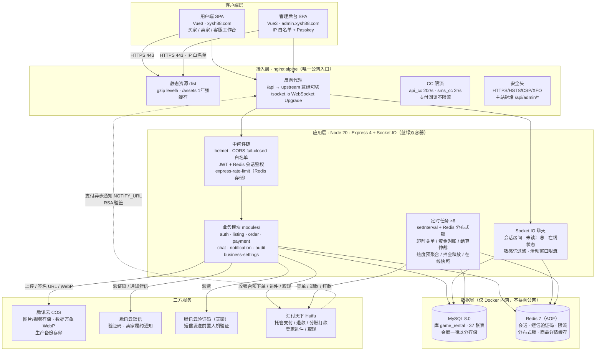

架构要点：

- **鉴权**：JWT（HS256）+ Redis 服务端会话双轨。Token 经 httpOnly Cookie（`auth_token`）传递，每次请求校验 Redis 会话，支持改密 / 封禁 / 角色变更即时吊销；管理员与客服的高危操作叠加 Passkey（WebAuthn）二次校验（428 `STEP_UP_REQUIRED` 协议）。
- **支付安全边界**：订单置为已支付**只**由支付回调 / 主动查单驱动，不暴露任何「确认支付」HTTP 路由；回调只信任渠道侧 RSA 验签解析出的数据，且做金额一致性校验。
- **可靠性替代 MQ**：无消息队列。跨系统异步一致（退款到账、打款到账、订单收口）依赖「DB 状态机 + reason/remark 幂等键 + 120s 资金对账定时任务 + 汇付查单」实现最终一致（见 4.6）。
- **多实例一致性**：蓝绿双容器并存期间，定时任务用 Redis 分布式锁保证同轮只跑一次；限流计数走 Redis 共享。

### 1.2 部署架构图

单机部署：1 台腾讯云 CVM，docker-compose 编排 5 个容器。

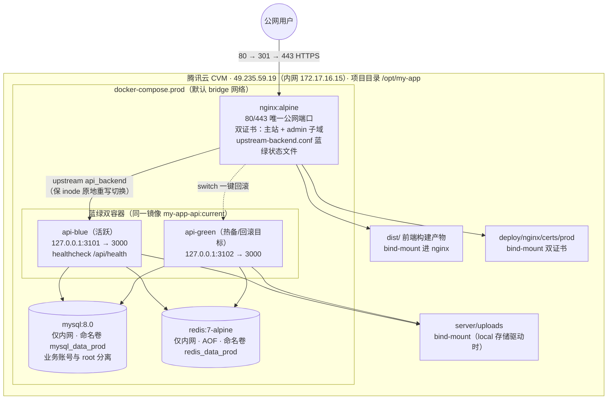

部署事实清单：

| 项 | 值 |
| --- | --- |
| 服务器 | 腾讯云 CVM ×1，公网 49.235.59.19，内网 172.17.16.15 |
| 容器 | nginx / api-blue / api-green / mysql:8.0 / redis:7-alpine，同一 compose bridge 网络 |
| 端口暴露 | 仅 nginx 80/443 对公网；api 双容器仅绑 127.0.0.1（3101/3102，调试用）；MySQL/Redis 无端口映射 |
| 持久化 | 命名卷 `mysql_data_prod`、`redis_data_prod`；bind-mount：`dist`（前端）、`server/uploads`、证书目录、nginx 配置 |
| 健康检查 | api 容器 wget `/api/health`（start_period 60s，启动需先跑 schema 引导）；优雅停机时返回 503 `shutting_down` |
| 优雅停机 | `stop_grace_period: 30s`；应用内顺序：健康检查 503 → 停定时任务 → 断 WebSocket（3s 兜底）→ 排干在途 HTTP ≤15s |
| 日志 | json-file 轮转 10MB ×3；MySQL 慢查询阈值 0.5s |
| 时区 | 全链路北京时间（TZ=Asia/Shanghai，MySQL +08:00） |

### 1.3 蓝绿发布与回滚

发布/回滚由 `deploy/scripts/blue-green-deploy.sh`（子命令 `deploy` / `switch` / `status`）驱动：

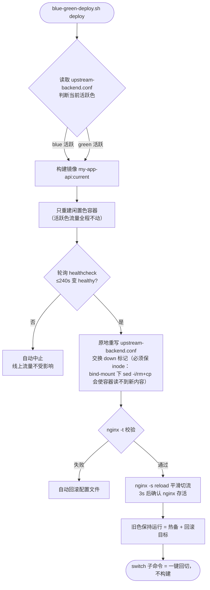

要点：

- 切换原子性在 nginx 配置层完成，应用零停机；`worker_shutdown_timeout 30s` 保证 reload 后旧 worker 最多存活 30s，避免 socket.io 长连接把旧 worker 无限留住。
- 部署脚本对 nginx 配置采用「保 inode 的原地重写」（`cat >` 覆盖而非替换文件），这是 bind-mount 场景的硬约束。

### 1.4 发布链路

```
本地 npm run build（vite build，产出 dist/）
  → tar 精简发布包（排除 node_modules / uploads / .env / certs / 白名单 / upstream 状态）
  → scp 上传服务器 /opt/my-app
  → remote-deploy-extract.sh 解包（回填恢复 prod.env、certs、uploads、白名单、upstream，全程保目录 inode）
  → blue-green-deploy.sh deploy（构建 → 起闲置色 → 健康检查 → 切流）
```

配套运维脚本（`deploy/scripts/`）：`backup-prod.sh`（MySQL dump + uploads 打包双上传 COS）、`check-prod-*`（主机指标/磁盘/MySQL 巡检）、`reset-prod-admin.sh`、`rotate-db-credentials.sh`（DB 密码轮换）、`update-admin-allowlist.sh` / `admin-allowlist-expire.sh`（后台 IP 白名单维护与到期收紧）。

---

## 2. 技术栈

### 2.1 前端（src/ 用户端 + src-admin/ 管理端）

| 类别 | 选型 | 版本 | 说明 |
| --- | --- | --- | --- |
| 框架 | Vue | ^3.5 | Options API 为主，部分 `<script setup>` |
| 路由 | vue-router | ^4.6 | 用户端 history 模式（原生 App 壳内 hash）；管理端 hash 模式 |
| 构建 | Vite | ^8.0 | 多页入口：`index.html`（主站）+ `admin.html`（后台） |
| 状态 | — | — | 无 Pinia/Vuex；composables 模块级 reactive 单例（`useSessionShell`、`useHomeListState` 等） |
| 实时通信 | socket.io-client | ^4.8 | 聊天、未读红点、客服工单提醒 |
| 图表 | echarts | ^6.1 | 管理端数据看板（按需引入） |
| 样式 | 手写 CSS | — | 明暗主题（View Transitions）；PC ≥961px / 移动 ≤960px 双端适配 |

### 2.2 后端（server/，ESM 单体）

| 类别 | 选型 | 版本 | 说明 |
| --- | --- | --- | --- |
| 运行时 | Node.js | 20（alpine 镜像） | 单进程多容器（蓝绿） |
| Web 框架 | express | ^4.21 | REST API；body 2MB 上限，保留 rawBody 供支付回调验签 |
| 数据库驱动 | mysql2 | ^3.14 | promise 连接池，手写 SQL（无 ORM）；库 `game_rental` |
| 缓存/锁 | redis | ^6.0 | 会话、验证码、限流、分布式锁、商品详情缓存；不可用时降级内存 |
| 实时 | socket.io | ^4.8 | 聊天房间、未读推送、在线状态 |
| 鉴权 | jsonwebtoken | ^9.0 | HS256 + Redis 会话（可吊销） |
| 密码 | bcryptjs | ^3.0 | cost 10（占位密码/运维重置用，登录已全面转短信验证码） |
| WebAuthn | @simplewebauthn/server | ^13.3 | 管理员/客服 Passkey 二次校验 |
| 限流 | express-rate-limit + rate-limit-redis | ^8.5 / ^5.0 | Redis 共享计数；socket 消息走 ZSET 滑动窗口 |
| 安全头 | helmet | ^8.1 | CSP、nosniff 等 |
| 上传 | multer | ^2.1 | 内存存储 + 文件名白名单校验 + 日配额 |
| 对象存储 | cos-nodejs-sdk-v5 | ^2.15 | 上传/删除；读 URL 自研 HMAC-SHA1 窗口对齐签名 |
| 三方 SDK | tencentcloud-sdk-nodejs-sms / -captcha / -faceid | ^4.1 | 短信、天御验证码（faceid 已从主链路移除） |
| 配置 | dotenv | ^16 | 环境变量驱动，生产 `deploy/env/prod.env` |

### 2.3 基础设施与工程化

| 类别 | 选型 | 说明 |
| --- | --- | --- |
| 容器编排 | docker-compose（prod/dev/test 三套） | 5 服务；蓝绿发布脚本见 1.3 |
| 反向代理 | nginx:alpine | TLS 终止、gzip、限流、静态资源、WebSocket |
| 数据库 | MySQL 8.0 | utf8mb4_unicode_ci / InnoDB；时区 +08:00；慢查询 0.5s；max_connections 200 |
| 缓存 | Redis 7-alpine（AOF） | 见 4.5 |
| 消息队列 | **无** | 用「DB 状态机 + 定时任务对账 + 幂等键」替代，见 4.6 |
| 定时任务 | Node 进程内 setInterval ×6 | 进程内重入保护 + Redis 跨实例分布式锁，见 4.6 |
| 部署 | scp + blue-green-deploy.sh | 零停机发布、一键回滚 |
| 版本管理 | git（GitHub 私库） | main 单分支直发生产 |

---

## 3. 前端页面结构

### 3.1 工程与入口

单仓双 SPA，Vite 多页构建（`vite.config.js` rollupOptions.input）：

| 应用 | 入口 | 源码 | 域名 / 访问 | 路由模式 |
| --- | --- | --- | --- | --- |
| 用户端 | `index.html` | `src/` | xysh88.com / www.xysh88.com | history（原生 App 壳内自动降级 hash） |
| 管理后台 | `admin.html` | `src-admin/` | admin.xysh88.com（IP 白名单） | hash（`createWebHashHistory`） |

两个 SPA 共用同一 API 集群与 Cookie 会话；客服工作台不在 admin 端，而在**主站** `/support-console`（role=support 可见），复用主站登录态。

用户端布局壳 `AppShell.vue`（唯一布局）：PC（≥961px）左侧固定 SideBar 240px；移动端（≤960px）MobileTopBar + 底部五 Tab（首页/改枪码/发布/代肝/我的）。全局弹层 AppToast / AppConfirm；**登录面板 `AuthPanel` 不是路由页**，而是全屏替换主内容区（`showAuth` 状态驱动）。无全局路由守卫，鉴权由各页面 mounted 自查 + `apiFetch` 401 统一处理（清态 + 弹登录）。首页 KeepAlive 缓存 + `useHomeListState` 列表状态快照，实现「详情返回原位」。

### 3.2 用户端路由与页面结构

| 路径 | 视图 | 页面功能 |
| --- | --- | --- |
| `/` | HomePage | 商品列表首页：10 维筛选、8 维排序、小额/特惠专区开关、编号搜索、无限滚动（10/页） |
| `/listings/:listingNo` | ListingDetailPage | 商品详情：属性/额外物品/图片/封禁凭证；买家下单入口（协议勾选 + OrderModal）；带只读模式（个人中心/卖家视角复用） |
| `/publish` · `/publish/:id/edit` | PublishPage | 发布 / 编辑出租表单（定价自动推导、额外物品、媒体上传、保险三档） |
| `/profile` | ProfilePage | 个人中心，6 个 Section（query 驱动）：我发布的（含卖家订单 Tab）/ 我买到的 / 我的消息 / 邀新赚钱 / 收款账号 / 问题反馈 |
| `/orders/:id` | OrderDetailPage | 订单详情（`?role=buyer|seller` 双视角）：状态机操作、物品申报、押金保管卡、聊天入口、支付入口 |
| `/payment/result` | PaymentResultPage | 支付回跳结果页（3s×20 次轮询确认支付状态） |
| `/support-console` | SupportConsolePage | 客服工作台（role=support）：售后/售前工单、商品审核、Passkey 安全设置 |
| `/gun` | GunCodePage | 改枪码静态分享页（按枪械分类一键复制，无需登录） |
| `/boost` | — | 代肝板块占位（未上线，点击提示开发中） |

```
xysh88.com（AppShell 壳）
├─ / 首页商品列表 ──点击卡片──▶ /listings/:listingNo 商品详情
│                                   └─ OrderModal 下单 ──▶ /profile?section=orders（待付款）
│                                          └─ PaymentModal ──▶ 汇付收银台 ──回跳──▶ /payment/result
│                                                 └─▶ /orders/:id?role=buyer 订单详情
├─ /publish（发布）/ /publish/:id/edit（编辑）
├─ /profile（个人中心）
│    ├─ Section=published  我发布的（商品管理 + 卖家订单 Tab）
│    ├─ Section=orders     我买到的（买家订单）
│    ├─ Section=messages   我的消息（会话 + 系统通知，开 ConversationPanel）
│    ├─ Section=invite     邀新赚钱
│    ├─ Section=wallet     收款账号（进件/绑卡/余额/提现/记录）
│    └─ Section=feedback   问题反馈
│    └─ 订单卡 ──▶ /orders/:id?role=buyer|seller
├─ /support-console 客服工作台（support 角色）
├─ /gun 改枪码 · /boost 代肝占位
└─ 全局浮层：AuthPanel 登录 · ConversationPanel 聊天（订单/售前） · AppToast/AppConfirm
```

### 3.3 用户端关键组件

| 组件 | 用途 |
| --- | --- |
| SideBar / MobileTopBar / BottomNav / AppFooter | 导航壳（PC/移动）与备案页脚 |
| AuthPanel | 手机验证码登录面板（天御验证码前置、协议弹窗、邀请码绑定） |
| FilterBar / SortBar / ProductCard | 首页列表套件（筛选 10 项、排序 8 项、商品卡含分享/复制编号） |
| ListingDetail + OrderModal | 商品详情主体与确认下单弹窗（联系方式 + 价格明细） |
| PaymentModal | 收银台弹窗（支付宝 PC 整页跳转 / H5；弹内轮询 + 到期自动关单） |
| OrderDetail | 订单详情主体（双视角、状态机按钮区、物品申报表单、押金保管卡、时间线） |
| PublishForm | 发布/编辑大表单（2530 行，含定价自动计算与媒体上传排序） |
| ProfileCenter + profile/ProfileMessagesPanel + profile/ProfileWalletPanel | 个人中心各 Section 主体 |
| ConversationPanel | 抽屉式聊天面板（订单三方会话/售前咨询，socket 实时 + 多图上传 + 敏感词） |
| SupportConsole + support/ListingReviewDesk | 客服工作台（工单台 + 审核台 + Passkey） |
| GunCode | 改枪码静态页 |

### 3.4 状态管理与数据流

无 Pinia/Vuex，采用 composables 模块级单例：

| composable / util | 职责 |
| --- | --- |
| `useSessionShell` | 登录态核心：currentUser/isLoggedIn/showAuth、401 统一处理、登出 |
| `useUnreadSocket` | 全局 socket.io 连接：message/notification 事件族驱动全局未读红点 |
| `useHomeListState` | 首页列表筛选/页码/滚动位置快照与还原 |
| `useRouteShellUi` / `useTheme` | 导航高亮与返回逻辑 / 明暗主题（View Transitions） |
| `utils/api.js` | 统一请求（Cookie credentials、30s 超时、非 2xx 抛错） |
| `utils/businessSettings.js` | 后台业务参数镜像（佣金/阈值/选项/价目下发前端，含默认值兜底） |
| `utils/media.js` | 图片变体 `?variant=thumb|mid|full`（数据万象 WebP）、失败回退、JPEG 压缩上传 |
| `utils/money.js` | 分↔元换算、买家租金（卖家租金×(1+买家服务费率)）、卖家到手估算 |
| `utils/supportPasskey.js`（主站）/ `utils/api.js`（admin） | WebAuthn Passkey 注册与 step-up 428 自动补验封装 |

### 3.5 管理后台页面结构（src-admin）

侧边栏导航与路由表由同一 `adminSections` 数组驱动，页面 KeepAlive。登录页（手机号短信 scene=admin_login + 前置天御验证码）校验 `role=admin` 后进入；启动拉取 `/api/admin/health` 展示服务状态。

| 路径 | 视图 | 功能 |
| --- | --- | --- |
| `/overview` | AdminOverview | 运营概览卡（用户/商品/订单/售后数）、echarts 趋势看板（销量/注册/在线，日/月/年/自定义）、收益明细（平台抽成/卖家入账/订单维度） |
| `/users` | AdminUsersCenter | 用户管理：搜索、角色变更（user/support/admin）、封禁（1-3650 天）/解封、客服改名（快照审计） |
| `/orders` | AdminOrdersCenter | 订单管理：搜索/日期筛选、30s 静默刷新、关闭订单（已付款→原路退款；资金在途场景禁用按钮） |
| `/listings` | AdminListingsCenter | 商品管理：搜索/分页、下架商品 |
| `/listing-reviews` | ListingReviewCenter | 商品审核：三页签详情（属性/额外物品/凭证媒体）、通过/驳回（驳回必填原因） |
| `/feedback` | AdminFeedbackCenter | 问题反馈：状态流转（处理中/已解决/驳回）+ 处理备注 |
| `/business-settings` | AdminBusinessSettingsCenter | 平台参数配置三页签：业务规则（比例/押金/佣金/邀新/冷静期/阈值/安全限流）、保险赔付方案、额外物品双边定价 |
| `/operation-logs` | OperationLogCenter | 操作日志审计（模块/动作/对象/前后快照 JSON） |
| `/security` | AdminSecurityCenter | 安全设置：Passkey 管理（绑定需短信验证）、受信任设备（30 天）、step-up 策略说明 |

高危操作（改角色/封禁/关单/下架/审核/改参数/Passkey 删除等）统一走 step-up：后端返回 428 → 前端自动拉起 Passkey WebAuthn 验证后重放请求（`runProtectedAction` 模式）。

---

## 4. 数据库设计

### 4.1 总览

数据库 `game_rental`，共 **37 张表**，InnoDB / utf8mb4_unicode_ci。**所有金额字段以「分」为单位的 BIGINT 存储**（序列化层输出元）。商品/订单大量使用快照字段（卖家名、标题、租金、物品单价），保证历史可追溯。

表结构由两处共同定义：`server/schema.sql`（初始建库）+ 启动时幂等迁移（`app.js` 的 `ensure*Schema()` 系列，顺序见 `bootstrap/schema.js`；SQL 迁移文件在 `server/migrations/`，执行记录入 `schema_migrations` 账本）。

| 域 | 表 |
| --- | --- |
| 用户域（3） | users、admin_passkeys、admin_trusted_devices |
| 商品域（6） | listings、listing_items、listing_images、listing_ban_images、listing_click_users、listing_hot_stats |
| 订单/支付/结算域（13） | orders、order_item_snapshots、order_item_usage_reports、order_settlements、order_deposit_holds、payment_transactions、payment_refunds、settlement_payouts、encashments、wallet_accounts、wallet_ledger、user_settlement_accounts、invite_rewards |
| 纠纷/客服域（3） | support_order_events、presale_consultations、user_feedback |
| 消息域（4） | conversations、conversation_participants、conversation_messages、conversation_message_uploads |
| 通知域（1） | user_notifications |
| 配置/运营/风控域（7） | admin_business_settings、admin_operation_logs、admin_online_snapshots、sms_send_daily_stats、sms_send_ip_daily_stats、user_upload_daily_stats、schema_migrations |

### 4.2 ER 图

#### 4.2.1 全表关系总图（物理 FK + 逻辑引用）

```mermaid
erDiagram
    users ||--o{ listings : "owner_user_id 发布"
    users ||--o{ orders : "buyer_id 买入"
    users |o--o{ orders : "seller_id 卖出"
    users |o--o{ users : "inviter_user_id 邀请(自关联)"
    listings ||--o{ orders : "被下单"
    listings ||--o{ listing_items : "额外物品"
    listings ||--o{ listing_images : "展示图"
    listings ||--o{ listing_ban_images : "处罚截图"
    listings ||--o{ listing_click_users : "点击去重"
    listings ||--|| listing_hot_stats : "7日热度(1:1)"
    users ||--o{ listing_click_users : "点击"

    orders ||--o{ order_item_snapshots : "物品快照"
    orders ||--o{ order_item_usage_reports : "物品使用申报"
    orders ||--|| order_settlements : "结算单(1:1)"
    orders ||--o| order_deposit_holds : "押金保管(1:1)"
    orders ||--o| invite_rewards : "邀新返现(1:1)"
    orders ||--o{ support_order_events : "工单时间线"
    orders ||--o{ settlement_payouts : "打款单"
    orders ||--o{ payment_transactions : "支付流水"
    orders ||--o{ payment_refunds : "退款单"
    orders ||--o{ wallet_ledger : "钱包流水"
    payment_transactions ||--o{ payment_refunds : "transaction_no 原路退"

    users ||--|| wallet_accounts : "钱包(1:1)"
    users ||--|| user_settlement_accounts : "汇付收款账户(1:1)"
    users ||--o{ wallet_ledger : "钱包流水"
    users ||--o{ payment_transactions : "支付"
    users ||--o{ payment_refunds : "退款"
    users ||--o{ encashments : "取现"
    users ||--o{ invite_rewards : "inviter/invitee"
    users ||--o{ admin_passkeys : "Passkey凭证"
    users ||--o{ admin_trusted_devices : "受信任设备"
    users ||--o{ presale_consultations : "发起咨询"
    users ||--o{ user_feedback : "问题反馈"
    users ||--o{ user_notifications : "站内通知"

    conversations ||--o{ conversation_participants : "参与人"
    conversations ||--o{ conversation_messages : "消息"
    conversations ||--o{ conversation_message_uploads : "图片暂存"
    users ||--o{ conversation_participants : "参与"
    presale_consultations ||--o| conversations : "咨询会话(逻辑ref_id)"

    orders ||--o| conversations : "订单会话(逻辑 type+ref_id)"
```

> 实线为物理外键（InnoDB 约束）；标注「逻辑」的为代码层维护的引用（无 FK 约束）：`conversations.(type,ref_id)` → orders / presale_consultations、`listings.reviewed_by / review_assignee_id`、`orders.support_assignee_id` 等客服派单字段、`order_settlements.executed_by_support_id`、`payment_refunds.transaction_no`、多态引用 `user_notifications.(related_type,related_id)` 等。

#### 4.2.2 用户域 + 商品域（核心字段）

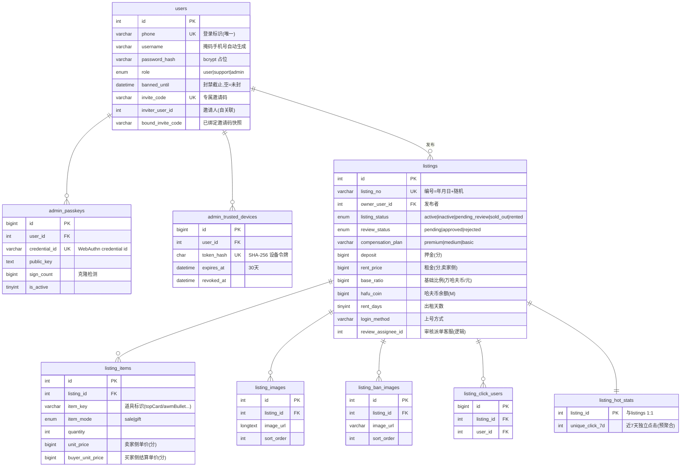

#### 4.2.3 订单 / 支付 / 结算域（核心字段）

```mermaid
erDiagram
    orders {
        int id PK
        varchar order_no UK
        int buyer_id FK
        int seller_id FK "删卖家置NULL"
        int listing_id FK
        bigint seller_rent_amount "卖家租金快照(分)"
        bigint amount "买家租金(分,含买家服务费)"
        bigint deposit_amount "押金(分)"
        enum status "7态,见4.3"
        enum settlement_status "none|buyer_reported|seller_confirmed|executed"
        varchar support_scene "none|cancel_request|settlement_dispute|fund_frozen|deposit_dispute|*processing"
        enum support_status "none|pending|handling|resolved"
        int support_assignee_id "负责客服(逻辑)"
        varchar support_origin_status "冻结前原状态快照"
        datetime paid_at
        datetime verified_at "买家确认账号"
    }
    order_item_snapshots {
        int id PK
        int order_id FK
        varchar item_key UK "uk(order_id,item_key)"
        enum item_mode "sale|gift"
        bigint unit_price "卖家侧快照(分)"
        bigint buyer_unit_price "买家侧快照(分)"
    }
    order_item_usage_reports {
        int id PK
        int order_id FK
        varchar item_key UK
        int snapshot_quantity "快照数量"
        int reported_quantity "买家填报使用量"
        bigint buyer_total_price "买家侧扣款(分)"
        tinyint seller_confirmed "卖家确认"
    }
    order_settlements {
        int id PK
        int order_id FK "UNIQUE 1:1"
        bigint platform_fee_amount "平台抽成(分)"
        bigint seller_income_amount "卖家入账(分)"
        bigint buyer_refund_amount "买家退款(分)"
        enum payout_mode "huifu|manual 手动结单"
        enum frozen_liable_party "seller|buyer 冻结裁决责任方"
        enum status "draft|executed"
        varchar manual_payout_note "线下收款留痕"
    }
    order_deposit_holds {
        bigint id PK
        int order_id FK "UNIQUE 1:1"
        bigint hold_amount "保管押金(分)"
        enum status "holding|disputed|releasing|released|confiscating|confiscated"
        int hold_days "冷静期天数快照"
        datetime release_at "预计退回"
        enum verdict "refund|confiscate 裁决"
        varchar refund_reason "退款幂等键"
        varchar payout_remark "打款幂等键"
    }
    payment_transactions {
        bigint id PK
        varchar transaction_no UK "PAY+日期+随机"
        int user_id FK
        int order_id FK "删订单置NULL"
        bigint amount "金额(分)"
        enum status "created|pending|paid|failed|cancelled|closed"
        enum business_sync_status "pending|synced|failed"
        varchar provider_trade_no "汇付交易号"
        datetime expires_at
    }
    payment_refunds {
        bigint id PK
        varchar refund_no UK "RFD+日期+随机"
        varchar transaction_no "原支付流水(逻辑)"
        int order_id FK
        enum refund_type "full|partial"
        bigint amount
        varchar reason "幂等键(场景固定文案)"
        enum status "pending|processing|success|failed|cancelled"
    }
    settlement_payouts {
        bigint id PK
        varchar payout_no UK "POT+..."
        int order_id FK
        int payee_user_id FK "收款卖家"
        bigint amount
        enum status "pending|processing|success|failed|cancelled"
        varchar payee_huifu_id "卖家汇付ID"
        varchar remark "幂等键"
    }
    encashments {
        bigint id PK
        varchar encashment_no UK "取现请求号"
        int user_id FK
        bigint amount
        enum status "pending|processing|success|failed|cancelled"
        varchar into_acct_date_type "D1|T1|TS"
        varchar trans_stat "汇付原始 P|S|F|C"
    }
    user_settlement_accounts {
        int user_id PK "FK=users 1:1"
        enum account_type "person|enterprise"
        enum bind_status "unbound|pending|active|disabled"
        varchar huifu_id "汇付用户ID"
        varchar acct_id "绑卡token_no"
        varchar id_card_masked "脱敏证件"
    }
    invite_rewards {
        bigint id PK
        int order_id FK "UNIQUE 1单1条"
        int inviter_user_id FK "邀请人"
        int invitee_user_id FK "下单买家"
        decimal reward_rate_percent "默认30%"
        bigint reward_amount "返现(分)"
        enum payout_status "pending|paid|failed|wallet_credited"
    }

    orders ||--o{ order_item_snapshots : ""
    orders ||--o{ order_item_usage_reports : ""
    orders ||--|| order_settlements : ""
    orders ||--o| order_deposit_holds : ""
    orders ||--o| invite_rewards : ""
    orders ||--o{ payment_transactions : ""
    payment_transactions ||--o{ payment_refunds : "原路退"
    orders ||--o{ payment_refunds : ""
    orders ||--o{ settlement_payouts : ""
    users ||--o{ encashments : ""
    users ||--|| user_settlement_accounts : ""
```

（钱包两表 `wallet_accounts`（user_id 主键 1:1，balance/frozen_balance）、`wallet_ledger`（流水分账前/后余额快照）结构简单，见总图关系。）

#### 4.2.4 消息域 + 配置域（核心字段）

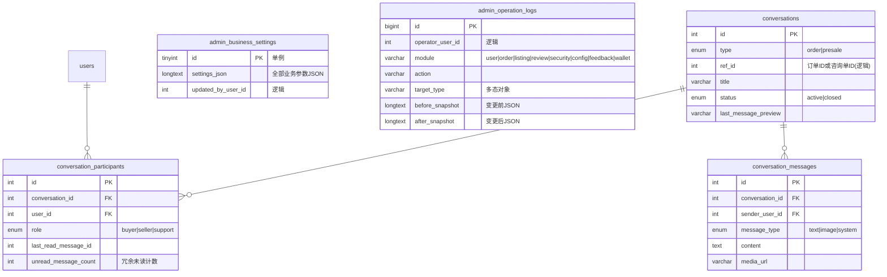

### 4.3 关键状态机

**orders.status（7 态主状态机）**：

```
pending_payment 待支付 → paid 已支付(履约中) → settlement_pending 待结算 → deposit_holding 押金保管 → completed 已完成
                                    ↘ support_handling 客服处理中（旁路态，可回主流程或转 cancelled）
        pending_payment 超时 → cancelled（商品恢复上架）
```

| 字段 | 枚举与含义 |
| --- | --- |
| orders.status | pending_payment 待支付 / paid 已支付·履约中 / support_handling 客服处理中 / settlement_pending 待结算 / deposit_holding 押金保管·冷静期 / completed 已完成 / cancelled 已取消 |
| orders.settlement_status | none 未结算 / buyer_reported 买家已申报物品 / seller_confirmed 卖家已确认 / executed 已分账 |
| orders.support_scene | none / cancel_request 取消请求 / settlement_dispute 结算争议 / fund_frozen 资金冻结 / deposit_dispute 押金举报 / cancel_refund_processing、settlement_funds_processing、frozen_funds_processing、admin_close_refund_processing、deposit_funds_processing（资金在途中间态，由对账任务收口） |
| orders.support_status | none / pending 待领取 / handling 处理中 / resolved 已解决 |
| listings.listing_status | active 上架 / inactive 下架 / pending_review 审核中 / sold_out 已售出 / rented 已租出（有进行中订单；取消/完成后恢复） |
| listings.review_status | pending 待审 / approved 通过 / rejected 驳回 |
| order_deposit_holds.status | holding 保管中 / disputed 已举报待裁决 / releasing 退款中 / released 已退买家 / confiscating 赔付中 / confiscated 已赔卖家 |
| order_settlements.status / payout_mode / frozen_liable_party | draft / executed；huifu 汇付打款 / manual 客服线下收款；冻结裁决责任方 seller / buyer |
| payment_transactions.status | created / pending / paid / failed / cancelled / closed |
| payment_refunds / settlement_payouts / encashments.status | pending / processing / success / failed / cancelled |

### 4.4 库内预聚合与冗余计数（MySQL 侧「缓存表」）

| 表/列 | 作用 | 刷新方式 |
| --- | --- | --- |
| listing_hot_stats | 商品 7 日独立点击预聚合，列表页直接 JOIN 免实时 GROUP BY | 定时任务 60s 重算 |
| listing_click_users | 热度统计的点击去重明细（源数据） | 写入时 UPSERT |
| admin_online_snapshots | 在线人数时序快照（趋势图数据源） | 定时任务 60s 追加 |
| sms_send_daily_stats / sms_send_ip_daily_stats | 短信按手机号/按 IP 日频控计数 | UNIQUE 键 + 计数累加 |
| user_upload_daily_stats | 用户日上传配额（默认 100MB/天） | 同上，失败回滚 |
| conversation_participants.unread_message_count | 会话未读数冗余列 | 收发消息/已读时重算 |
| orders/listings 快照字段 | 卖家名/标题/租金/物品单价等，历史不随源变 | 下单/发布时写入 |

### 4.5 Redis 缓存 key 设计

Redis（`REDIS_KEY_PREFIX` 统一前缀，AOF 持久化），不可用时全部降级内存实现（限流降级为单实例计数）：

| 用途 | 键模式（功能名） | TTL / 配置项 | 说明 |
| --- | --- | --- | --- |
| 登录会话 | `login_sessions:{sid}` | user 会话 7 天·空闲 12h；admin 24 天内·空闲 30min（`USER/ADMIN_LOGIN_SESSION_TTL_SECONDS`、`*_SESSION_IDLE_TIMEOUT`） | JWT 内 sid 的服务端状态；支持吊销/续签（续签窗口 15min） |
| 短信验证码 | 验证码状态键（手机号+scene） | `SMS_CODE_TTL_SECONDS`；发送间隔 `SMS_CODE_SEND_INTERVAL_SECONDS`；校验错误锁定 `SMS_CODE_VERIFY_LOCK_SECONDS` | 与 DB 日限额表双层防刷 |
| HTTP 限流 | `RATE_LIMIT_REDIS_PREFIX` 前缀的计数键（express-rate-limit + rate-limit-redis） | 各窗口见 5.x 限流表 | 蓝绿双实例共享计数 |
| Socket 滑动窗口限流 | ZSET 键（consume/rollback） | 消息 10s/50 次；聊天图 60s/5 次 | rate-limit-store.js 自研 ZSET 实现 |
| 分布式锁·订单 | 订单锁 | `ORDER_LOCK_TTL_MS` | 支付回调入账、结算执行等互斥；Redis 不可用 fail-open |
| 分布式锁·任务 | 任务锁 | `JOB_LOCK_TTL_MS` / `JOBS_LOCK_TTL_MS`（默认 300s） | 蓝绿双容器同轮任务只跑一次 |
| 商品详情缓存 | 商品 ID 维度缓存键 | `LISTING_DETAIL_CACHE_TTL_SECONDS`（默认 180s） | 公开商品详情读缓存；后台改配置/审核后失效 |
| 用户信息缓存 | 进程内 Map（非 Redis） | `AUTH_USER_CACHE_TTL_MS`（默认 30s） | 角色/封禁以 DB 为准的短缓存 |
| 在线状态 | 用户在线心跳键 | `CHAT_ONLINE_TTL_SECONDS`（默认 120s，心跳 ≥15s） | 在线人数统计、客服在线列表 |

### 4.6 中间件说明（为什么没有 MQ）

系统未引入 RabbitMQ / Kafka。跨系统（汇付）异步结果驱动的最终一致性由以下机制等效实现：

| 常规 MQ 方案 | 本系统等效实现 |
| --- | --- |
| 支付成功消息 | 汇付异步回调（验签入账）+ 前端回站轮询触发主动查单 + 60s 超时任务兜底查单 |
| 退款/打款结果消息 | 120s 资金对账任务（`reconcileProcessingFundsOrders`）扫「资金在途」场景订单，逐单调汇付退款查单/打款查单推进状态；客服亦可手动触发「同步资金结果」 |
| 延迟队列（订单超时关闭） | 60s 轮询扫描 + 状态条件 UPDATE（`WHERE status IN (...)` 防并发），关单前强制先查单防误杀 |
| 幂等消费 | 业务幂等键：退款按 `payment_refunds.reason`、打款按 `settlement_payouts.remark` 唯一防重发；订单状态流转全部带 WHERE 守卫 |
| 死信/人工干预 | 查单失败留痕（`provider_query_status='failed'`、support_note「请人工核对资金状态」），客服工作台可见 |

代价与取舍：轮询有秒级延迟（对账 120s），但资金类操作低频（日均订单量级小），轮询 + 幂等 + 对账在当前容量下最简可靠；若订单量上两个数量级，优先引入延迟队列与退款/打款结果 webhook 的独立消费。

---

## 5. 接口设计

### 5.1 通用约定

| 项 | 约定 |
| --- | --- |
| Base URL | `/api`（nginx 反代至 Node；支付回调 `/api/pay/callback/:channel` 不限流，应用层验签） |
| 认证 | httpOnly Cookie `auth_token`（JWT HS256，payload 含 userId/role/sid/amr），亦接受 `Authorization: Bearer`；每次请求校验 Redis 会话，可即时吊销 |
| 请求体 | JSON，上限 2MB（保留 rawBody 供支付回调验签）；multipart 上传见 5.14 |
| 金额单位 | **存储与绝大多数响应为「分」（整数）**；发布/编辑商品的 `deposit` 等**入参以「元」提交**，后端 `yuanToCent` 换算；前端 `utils/money.js` 展示层换算 |
| 分页约定 | 响应 `{ list, total, page, pageSize }`；page 从 1 起，pageSize 各接口有上限（商品 50、订单/会话 20、通知 100、工单 100） |
| 时间 | 北京时间（UTC+8） |
| 错误响应 | 非 2xx，JSON `{ message, code? }`；关键状态码：401 未登录/会话失效、403 无权或封禁或来源不受信、409 并发冲突（如双审）、428 需二次校验、429 限流（含 `retry_after_seconds`） |
| 写来源校验 | 非幂等写请求校验 Origin/Host 一致（`isTrustedWriteOrigin`），跨源伪造拒绝 |

### 5.2 角色与鉴权中间件

| 角色 | 值 | 能力面 |
| --- | --- | --- |
| 普通用户 | `user` | 买家/卖家一体（发布即卖家、下单即买家） |
| 客服 | `support` | 主站 `/support-console`：售后/售前工单、商品审核、资金强操作（step-up） |
| 管理员 | `admin` | `admin.xysh88.com`：用户/订单/商品/参数/日志/反馈 |

中间件链：`authRequired`（登录）→ `supportOnly` / `adminOnly` → `requireStepUpAuth(policy)`（高危二次校验）。

**428 Step-up 协议**：高危动作未满足策略时返回 `428 { code: 'STEP_UP_REQUIRED', reason: 'passkey_required' | 'step_up_expired' | 'trusted_device_required', action, policy }`；前端拉起 WebAuthn 挑战 `POST /api/admin/step-up/options` → `POST /api/admin/step-up/verify`（通过后会话 amr 刷新，5~15 分钟有效）后重放原请求。策略覆盖：用户角色/封禁/关单/下架/商品审核/业务参数/Passkey 与受信任设备管理/批量操作（admin），以及客服侧取消订单/执行结算/冻结与释放资金/资金对账（support）。开关 `ADMIN_PASSKEY_ENABLED`、`SUPPORT_MONEY_STEP_UP_ENABLED`。

### 5.3 限流矩阵（应用层，Redis 共享计数）

| 限流器 | 窗口/阈值（默认） | 键 | 覆盖范围 |
| --- | --- | --- | --- |
| authLimiter | 5min / 10 | 手机号 | 登录验证码类 |
| authIpLimiter | 5min / 30 | IP | 认证类 |
| publicReadLimiter | 1min / 6000 | IP | 公开读（商品列表/详情） |
| authenticatedReadLimiter | 1min / 1800 | 用户 | 登录读 |
| authenticatedWriteLimiter | 1min / 120 | 用户 | 登录写 |
| orderWriteLimiter | 1min / 60 | 用户 | 订单/客服写 |
| publishLimiter | 1h / 5 | 用户 | 发布商品 |
| conversationApiLimiter | 1min / 1800 | 用户 | 会话接口 |
| uploadReadLimiter / uploadWriteLimiter | 1min / 120、1min / 20 | 用户 | 文件读 / 上传 |
| socket 消息 | 10s / 50 | 连接 | 聊天消息（ZSET 滑动窗口） |
| 聊天图片 | 60s / 5 | 用户 | 聊天图上传 |
| 上传日配额 | 100MB/天 | 用户 | DB 计数，失败回滚 |

（nginx 层另有兜底：api_cc 20r/s、sms_cc 2r/s、api_conn 并发 30。）

### 5.4 健康检查与公开配置

| 方法 | 路径 | 认证 | 功能 |
| --- | --- | --- | --- |
| GET | `/api/health` | 游客 | 健康检查（优雅停机时 503 `shutting_down`） |
| GET | `/api/health/storage` | 管理员 | 存储驱动状态（local/cos、托管目录） |
| GET | `/api/business-settings/public` | 游客 | 公开业务配置：比例推荐、外观选项、押金区间、佣金、赔付方案、道具价目（含买家侧升价） |

### 5.5 认证与账号

| 方法 | 路径 | 认证 | 功能与关键字段 |
| --- | --- | --- | --- |
| GET | `/api/auth/captcha/config` | 游客 | 天御验证码前端配置（js_url、app_id） |
| POST | `/api/auth/sms/send` | 游客 | 发短信验证码。入参 `phone, scene(login|admin_login), captcha_ticket, captcha_randstr`；前置验票 + 频控；429 返回 `retry_after_seconds/daily_limit/daily_count` |
| POST | `/api/auth/sms/login` | 游客 | 验证码登录（新号自动注册，可携 `invite_code` 一次性绑定）；Set-Cookie `auth_token` |
| POST | `/api/admin/login` | 游客 | 管理员验证码登录（非 admin 角色 403；单号日限收紧） |
| POST | `/api/logout` | 登录 | 注销会话并清 Cookie |
| GET | `/api/profile` | 登录 | 当前用户信息（角色、邀请码） |
| GET | `/api/invite/overview` | 登录 | 邀请返现总览（我的/已绑邀请码、双向返现明细，金额为分） |
| POST | `/api/invite/bind` | 登录 | 绑定邀请码（仅一次，不可改，不可自绑） |
| POST | `/api/register`、`/api/login`、`/api/auth/password/reset-by-sms` | — | **已下线（410）**：密码体系全面转短信验证码 |

### 5.6 商品公开浏览

| 方法 | 路径 | 认证 | 功能与关键参数 |
| --- | --- | --- | --- |
| POST | `/api/listings` | 登录（5/h） | 发布商品 → `pending_review` 自动派单最闲客服。入参含全部账号属性、定价（deposit 元）、额外物品 `{key:{quantity,itemMode}}`、图/凭证 URL；校验押金区间/覆盖率/比例区间/租期上限 |
| GET | `/api/listings` | 游客 | 商品列表：`page/pageSize≤50`、`sortBy`（hot/latest/rent/ratio/hafu/awm/helmet/armor 升降序 14 种）、筛选参数（保险/体力/负重/登录方式/刀皮/干员外观/编号/地区/小额专区/高比例专区/哈夫币/租金/押金/角色等级区间/道具）、响应含 7 日独立点击数 |
| POST | `/api/listings/:id/click` | 登录 | 点击埋点（热度统计去重 UPSERT） |
| GET | `/api/listings/:id` | 游客 | 商品详情（支持 id 或 listing_no；Redis 缓存 180s）：全字段 + items + images + 凭证媒体（凭证需登录） |

### 5.7 我的商品（卖家）

| 方法 | 路径 | 认证 | 功能 |
| --- | --- | --- | --- |
| GET | `/api/my-listings/stats` | 登录 | 我发布的商品状态统计 |
| GET | `/api/my-listings` | 登录 | 我的商品列表（status 筛选，pageSize≤20） |
| GET | `/api/my-listings/:id` | 登录(本人) | 商品详情（编辑回填，含卖家微信） |
| PUT | `/api/my-listings/:id` | 登录(本人) | 更新商品：重新进待审 + 重新派单 + 清理孤立媒体；pending_review/sold_out 不可改 |
| PATCH | `/api/my-listings/:id/status` | 登录(本人) | 上/下架切换（未审通过不可上架） |

### 5.8 订单（买家/卖家）

| 方法 | 路径 | 认证 | 功能 |
| --- | --- | --- | --- |
| GET | `/api/orders/stats`、`/api/seller/orders/stats` | 登录 | 我的（买家/卖家）订单状态统计 |
| GET | `/api/orders`、`/api/seller/orders` | 登录 | 我的订单列表（status 筛选 + keyword + 分页） |
| POST | `/api/orders` | 登录 | 创建订单：`listing_id, buyer_contact_wechat, accept_buyer_agreement, accept_payment_agreement`（协议版本 buyer-v1.1.0 / payment-v1.1.0）；锁商品行 + 快照；→ pending_payment |
| GET | `/api/orders/:id` | 登录(参与方) | 订单详情：完整订单 + 物品快照 + 使用申报 + 时间线 |
| PUT | `/api/orders/:id/cancel`、`/api/seller/orders/:id/cancel` | 登录(本人) | 取消订单（待付款可直接取消） |
| PUT | `/api/orders/:id/verify` | 登录(买家) | 确认账号正常继续履约（此后不可直接取消） |
| PUT | `/api/orders/:id/complete` | 登录 | 申请结算/完成订单 → settlement_pending |
| PUT | `/api/orders/:id/item-usage` | 登录(买家) | 填报额外物品使用 `items:[{item_key,reported_quantity}], note≤500` |
| PUT | `/api/orders/:id/item-usage/confirm` | 登录(卖家) | 确认物品申报（→ 可分账） |
| PUT | `/api/orders/:id/item-usage/reject` | 登录(卖家) | 不同意申报 → 结算争议转客服 |
| PUT | `/api/orders/:id/request-cancel` | 登录 | 发起取消申请（填原因，转客服） |
| PUT | `/api/orders/:id/respond-cancel` | 登录 | 响应对方取消申请 `agree:bool` |
| PUT | `/api/orders/:id/report-mismatch` | 登录(买家) | 上报账号不符/异常，转客服 |
| GET | `/api/orders/:id/settlement-preview` | 登录(参与方/被分配客服) | 结算预览：**金额按角色过滤**（买家见 buyer_refund_amount；卖家见 seller_income_amount；仅客服见 platform_fee_amount 与双边物品金额）；`mode=frozen&liableParty=` 冻结裁决预览 |
| POST | `/api/orders/:id/deposit-hold/report` | 登录(卖家) | 押金冷静期举报买家违规（转客服裁决） |

> 设计约束：**不存在「确认支付」路由**——订单置 paid 只由支付回调/主动查单驱动（防免费下单）。

### 5.9 客服工单（support）

| 方法 | 路径 | 认证 | 功能 |
| --- | --- | --- | --- |
| GET | `/api/support/orders` | 客服 | 我的售后工单：handling/resolved 桶 + 计数、**告警**（冻结≥48h `frozen_timeout`、押金举报≥48h）、工作量统计 |
| GET | `/api/support/orders/:id/timeline` | 客服(被分配) | 工单处理时间线（support_order_events） |
| PUT | `/api/support/orders/:id/note` | 客服(被分配) | 保存内部备注（500 字） |
| PUT | `/api/support/orders/:id/continue` | 客服 | 继续履约（cancel_request 场景恢复原状态） |
| PUT | `/api/support/orders/:id/return-to-settlement` | 客服 | 回结算中（settlement_dispute 场景） |
| PUT | `/api/support/orders/:id/cancel` | 客服 + StepUp | 取消订单（全额原路退款） |
| PUT | `/api/support/orders/:id/freeze-funds` | 客服 + StepUp | 冻结资金（填原因；仅 paid/settlement_pending） |
| PUT | `/api/support/orders/:id/release-funds` | 客服 + StepUp | 解除冻结（恢复原状态） |
| POST | `/api/support/orders/:id/reconcile-funds` | 客服 + StepUp | 手动资金对账（查退款/打款结果并收口） |
| PUT | `/api/support/orders/:id/execute-settlement` | 客服 + StepUp | 执行分账：`payoutMode(huifu|manual)、manualNote、liableParty(seller|buyer)`；冻结裁决/手动结单同入口 |
| PUT | `/api/support/orders/:id/deposit-verdict` | 客服 + StepUp | 押金举报裁决：`verdict(confiscate|reject)` |
| GET | `/api/support/presale-consultations` | 客服 | 售前咨询工单列表 |
| PUT | `/api/support/presale-consultations/:id/note` / `.../resolve` | 客服(被分配) | 售前备注 / 完成咨询（自动发系统消息） |

### 5.10 客服商品审核（support）

| 方法 | 路径 | 认证 | 功能 |
| --- | --- | --- | --- |
| GET | `/api/support/listing-reviews` | 客服 | 我的审核工单列表（status/keyword/分页 + 工作量统计） |
| GET | `/api/support/listing-reviews/:id` | 客服(被分配) | 审核详情（全量属性 + 凭证媒体） |
| PUT | `/api/support/listing-reviews/:id/approve` | 客服(被分配) | 通过（原子更新防双审，409 冲突） |
| PUT | `/api/support/listing-reviews/:id/reject` | 客服(被分配) | 驳回（原因必填；商品转 inactive + 站内通知卖家） |

### 5.11 支付与结算

| 方法 | 路径 | 认证 | 功能 |
| --- | --- | --- | --- |
| POST | `/api/pay/create` | 登录(买家) | 创建支付：`order_id, channel, scene, return_url`；返回 `transaction{ transaction_no, amount, jump_url, expires_at }`；超支付截止时间拒绝；pending 流水幂等复用 |
| GET | `/api/pay/transactions/:no` | 登录(本人) | 查流水（pending 时自动触发汇付查单收单） |
| POST | `/api/pay/transactions/:no/close` | 登录(本人) | 关单（先查单，刚支付成功则 409 引导走退款） |
| POST | `/api/pay/callback/:channel` | 渠道（RSA 验签） | 支付异步通知：只信任验签解析结果 + 金额一致性校验 + 状态守卫 UPDATE |
| GET | `/api/settlement-account` | 登录 | 我的收款账户 + 余额 + 商户门户地址 |
| PUT | `/api/settlement-account` | 登录 | 保存收款账户配置 |
| POST | `/api/settlement-account/register` | 登录 | 汇付个人开户（姓名/证件号/手机号/有效期） |
| POST | `/api/settlement-account/bind-card` | 登录 | 汇付绑卡入驻（持卡人/卡号/省市/证件） |
| GET | `/api/settlement-account/query-huifu` | 登录 | 查询汇付用户信息补全 token_no |
| POST | `/api/settlement-account/encashment` | 登录 | 发起取现（D1；单笔上限/每日 5 笔/余额校验） |
| GET | `/api/settlement-account/encashments` | 登录 | 取现记录 |
| POST | `/api/settlement-account/encashments/:no/sync` | 登录 | 取现查单同步 |
| GET | `/api/settlement/payouts` | 登录 | 我的结算打款记录 |

### 5.12 会话/聊天（HTTP 部分）

| 方法 | 路径 | 认证 | 功能 |
| --- | --- | --- | --- |
| POST | `/api/conversations/order/:orderId` | 登录(参与方) | 获取/创建订单三方会话 |
| POST | `/api/conversations/presale` | 登录(非客服) | 获取/创建我的售前咨询会话（自动派单客服） |
| GET | `/api/conversations` | 登录 | 我的会话列表（分页） |
| GET | `/api/conversations/unread-summary` | 登录 | 未读汇总（总数 + 售前/售后/客服分项） |
| GET | `/api/conversations/:id/messages` | 登录(参与方) | 拉取消息（分页，默认 50） |
| PUT | `/api/conversations/:id/read` | 登录(参与方) | 标记已读（并 socket 推送 message:read） |

### 5.13 通知与反馈

| 方法 | 路径 | 认证 | 功能 |
| --- | --- | --- | --- |
| GET | `/api/notifications`（+ `/unread-summary`） | 登录 | 通知列表 / 未读统计 |
| PUT | `/api/notifications/:id/read` | 登录(本人) | 标记已读 |
| GET | `/api/feedback/categories` | 登录(非admin) | 反馈分类（6 类） |
| POST | `/api/feedback` | 登录(非admin) | 提交反馈（≥5 字 ≤1000；每日限额） |
| GET | `/api/feedback/my` | 登录(非admin) | 我的反馈记录 |

### 5.14 文件上传与读取

| 方法 | 路径 | 认证 | 功能与约束 |
| --- | --- | --- | --- |
| GET | `/api/uploads/files/listing-images/:name` | 游客 | 商品图（local 直发 / COS 307 签名重定向，`?variant=thumb|mid|full`） |
| GET | `/api/uploads/files/ban-images/:name`、`/ban-videos/:name` | 登录+属主策略 | 处罚截图/封禁视频（admin/support/商品主/该商品买家可读） |
| GET | `/api/uploads/files/chat-images/:name` | 登录+会话参与 | 聊天图片 |
| POST | `/api/uploads/listing-images` | 登录 | 商品图上传：≤10 张、单张 ≤5MB、jpg/png/webp/gif |
| POST | `/api/uploads/ban-images` | 登录 | 处罚截图：≤5 张、单张 ≤5MB |
| POST | `/api/uploads/ban-video` | 登录 | 封禁记录视频：≤100MB、mp4/webm/ogg/mov |
| POST | `/api/uploads/chat-images` | 登录+会话参与 | 聊天图：≤5MB + 60s/5 次频控 |
| POST | `/api/uploads/recycle-temp` | 登录 | 回收未引用临时媒体 |

文件名白名单 `[A-Za-z0-9._-]+`；multer 内存存储；所有上传共享用户日配额（默认 100MB/天，DB 统计失败回滚）；存储驱动 `FILE_STORAGE_DRIVER=local|cos`。

### 5.15 管理后台（admin）

| 方法 | 路径 | 认证 | 功能 |
| --- | --- | --- | --- |
| GET | `/api/admin/health` / `/api/admin/profile` | 游客 / 管理员 | 后端健康 / 管理员信息 + Passkey 开关 |
| GET/POST/DELETE | `/api/admin/passkeys*` | 登录(admin/support) | Passkey 列表/注册（短信验证+WebAuthn 挑战）/删除（StepUp） |
| GET/POST/DELETE | `/api/admin/trusted-devices*` | 管理员 | 受信任设备列表/信任当前设备 30 天/移除（StepUp） |
| POST | `/api/admin/step-up/options` / `/verify` | 登录 | 二次校验挑战 / 验证（刷新会话 amr） |
| GET | `/api/admin/overview` | 管理员 | 总览指标（用户/商品/订单/售后数） |
| GET | `/api/admin/dashboard/trends` | 管理员 | 趋势分桶（销量/注册/在线 × 日/月/年/自定义） |
| GET | `/api/admin/revenue` | 管理员 | 收益报表（平台抽成/卖家入账/物品金额汇总 + 明细分页） |
| GET | `/api/admin/users` | 管理员 | 用户列表（keyword + 角色排序） |
| PUT | `/api/admin/users/:id/role` | 管理员 + StepUp | 变更角色（吊销其全部会话） |
| PUT | `/api/admin/users/:id/username` | 管理员 | 修改客服用户名（违禁词/重名校验） |
| PUT/DELETE | `/api/admin/users/:id/ban` | 管理员 + StepUp | 封禁（1-3650 天）/解封 |
| GET | `/api/admin/orders` | 管理员 | 订单列表（keyword/date） |
| PUT | `/api/admin/orders/:id/close` | 管理员 + StepUp | 关闭订单（未付款→汇付关单；已付款→原路退款；资金在途场景拒绝） |
| GET | `/api/admin/listings` | 管理员 | 商品列表 |
| PUT | `/api/admin/listings/:id/deactivate` | 管理员 + StepUp | 后台下架 |
| GET | `/api/admin/review/listings(/:id)` | 管理员 | 审核列表/详情 |
| PUT | `/api/admin/review/listings/:id/approve` / `/reject` | 管理员 + StepUp | 通过 / 驳回（原因必填） |
| GET/PUT | `/api/admin/business-settings` | 管理员（PUT + StepUp） | 业务参数读取/保存（归一化 + 审计 + 缓存失效） |
| GET | `/api/admin/operation-logs` | 管理员 | 操作日志（module/keyword/date + 快照） |
| GET/PUT | `/api/admin/feedback(/:id)` | 管理员 | 反馈处理（状态 + 备注，写审计） |

### 5.16 WebSocket（Socket.IO）

**连接鉴权**：握手中间件校验 JWT（`handshake.auth.token` / Bearer / Cookie）+ Redis 会话 + 未封禁，失败拒绝连接。**房间**：`user:{userId}`（连接即入）、`conversation:{conversationId}`（显式 join）。

客户端 → 服务端：

| 事件 | payload | 说明 |
| --- | --- | --- |
| `conversation:join` / `leave` | `{conversationId}` | 加入/离开会话房间（校验参与权，ack 返回会话） |
| `message:send` | `{conversationId, content, messageType, mediaUrl, mediaName, mediaSize}` | 发消息（10s/50 次滑动窗口限流；自动已读并广播；ack 回执） |
| `disconnect` | — | 清除在线状态 |

服务端 → 客户端：

| 事件 | 目标 | 说明 |
| --- | --- | --- |
| `message:new` | conversation:{id} | 会话新消息（含系统消息） |
| `message:notify` | user:{id} | 不在会话内的参与者未读提醒（含 unread_summary 分项） |
| `message:read` | user:{id} | 已读同步（HTTP read 与 socket 发送后均触发） |
| `support:desk:update` | user:{supportId} | 客服工单变更提醒（desk: aftersale/presale + reason） |
| `notification:notify` / `notification:read` | user:{id} | 站内通知新增/已读（含未读总数） |

---

## 6. 关键流程图

### 6.1 登录流程（用户短信验证码登录）

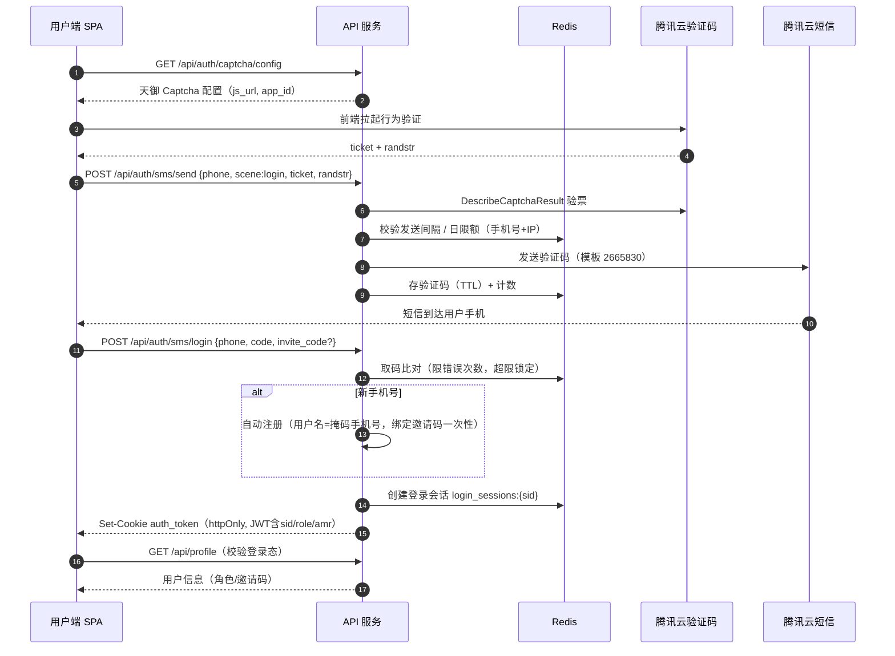

管理员/客服登录差异：`POST /api/admin/login`（scene=admin_login，单号日限收紧），非 admin 角色 403；登录后高危操作触发 **Passkey 二次校验**（428 `STEP_UP_REQUIRED` → 前端 `/api/admin/step-up/options` 发起 WebAuthn 挑战 → `/api/admin/step-up/verify` 通过后会话 amr 刷新，5~15 分钟有效；受信任设备 30 天内可豁免部分动作）。

### 6.2 支付流程（下单 → 汇付收银台 → 回调入账 → 履约启动）

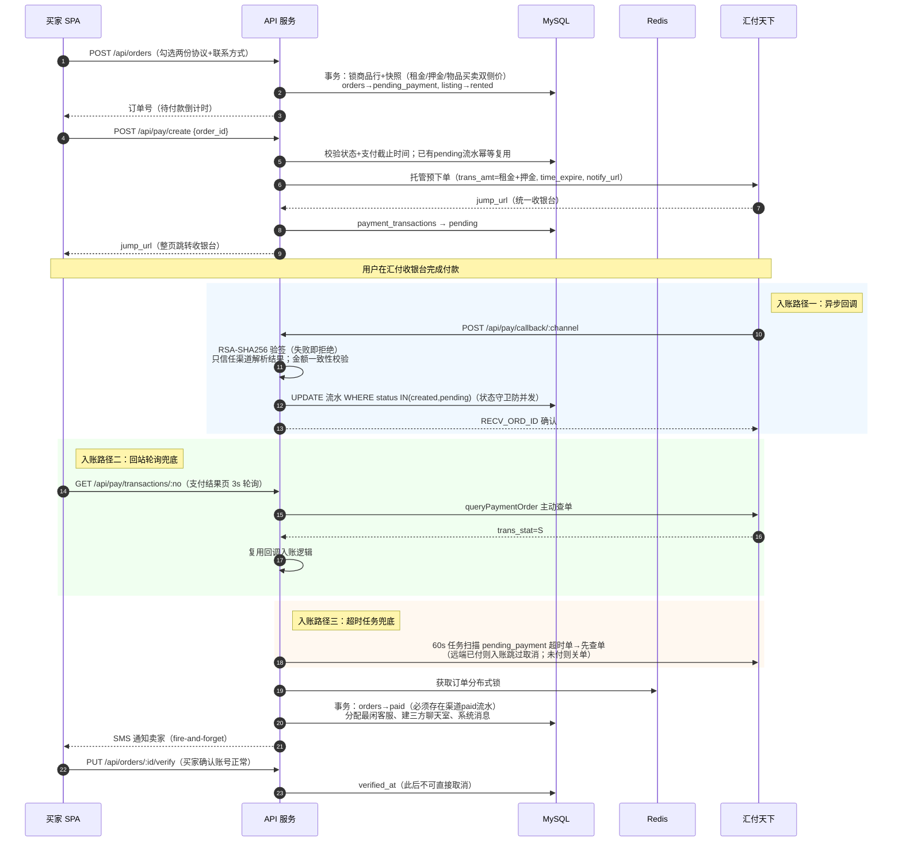

### 6.3 退款流程（客服取消全额退 & 结算押金退，同一退款引擎）

退款统一走 `paymentService.createOrderRefund`：以 `reason` 为幂等键（同单同场景只发一笔）、累计退款 ≤ 原支付金额、汇付 `htRefund` 原路退回、受理后异步查单确认。

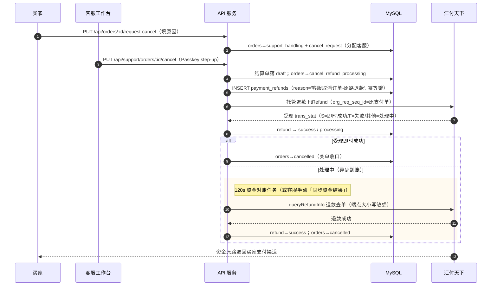

押金/结算类退款同引擎，仅幂等键（reason）与触发方不同：

| 场景 | reason（幂等键） | 触发方 |
| --- | --- | --- |
| 客服取消订单（全额=租金+押金） | 客服取消订单-原路退款 | 客服 step-up |
| 管理员后台关单（全额） | 管理员后台关单-原路退款 | 管理员 step-up |
| 普通结算：押金余额退买家 | 客服执行结算-押金原路退回 | 客服执行分账 |
| 冻结结算：押金余额退买家 | 客服执行冻结资金结算-押金原路退回 | 客服裁决（卖家责任时） |
| 押金冷静期到期自动退 | 押金保管到期-自动退回买家 | 60s 定时任务 |
| 押金举报驳回退买家 | 押金举报驳回-退回买家 | 客服裁决 |

### 6.4 结算与冻结裁决流程（资金出口，补充）

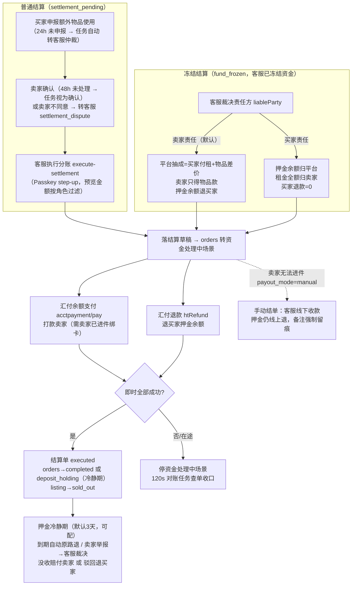

---

## 7. 三方依赖

### 7.1 依赖总表

| 服务商 | 服务 | 用途 | 关键配置项（名称） |
| --- | --- | --- | --- |
| 腾讯云 | COS 对象存储 | 商品图/处罚截图/封禁视频/聊天图存储；数据万象 imageMogr2 WebP 变体（thumb 500x / mid 1000x / full 1920x）；生产备份存储 | `COS_SECRET_ID/KEY`、`COS_BUCKET/REGION/KEY_PREFIX`、`COS_SIGNED_URL_EXPIRES/TTL/WINDOW_SECONDS`、`COS_IMAGE_VARIANTS_ENABLED`、`FILE_STORAGE_DRIVER=cos|local` |
| 腾讯云 | 短信 SMS | 登录验证码（模板 2665830）、管理员登录、Passkey 绑定验证（2694515）、卖家收款通知（模板 2717710，审核通过后配置自动生效；当前 prod.env 未填则静默跳过） | `TENCENT_SMS_SECRET_ID/KEY/SDK_APP_ID/SIGN_NAME`、`TENCENT_SMS_TEMPLATE_ID_*`、频控 `SMS_CODE_*` |
| 腾讯云 | 验证码（天御） | 短信发送前置人机验证（CaptchaType=9） | `TENCENT_CAPTCHA_APP_ID/APP_SECRET_KEY/BUSINESS_ID/SCENE_ID/JS_URL` |
| 汇付天下 | 资金托管支付 | 全站唯一支付通道：收银台、退款、余额分账打款、卖家进件、取现（详见 7.2） | `HUIFU_GATEWAY_URL/SYS_ID/PRODUCT_ID/HUIFU_ID`、商户私钥/平台公钥、`HUIFU_HOSTING_PROJECT_ID_PC/H5` 等、`HUIFU_NOTIFY_URL` |
| （无） | 微信 | **无真实集成**。微信仅作为业务字段（上号方式枚举、买卖家联系方式、聊天敏感词屏蔽「加微信/微信转账」）；`WECHAT_PAY_NOTIFY_URL` 为历史遗留配置 | — |
| （已移除） | 腾讯云 FaceID | SDK 仍在依赖中，KYC 已从主链路移除 | `KYC_*` 无需维护 |

### 7.2 汇付天下 API 调用点（13 个端点）

| # | 端点 | 用途 | 调用时机 |
| --- | --- | --- | --- |
| 1 | 托管预下单（`HUIFU_HOSTING_PREORDER_URL`，可配） | 收银台下单返回 jump_url | 买家发起支付 |
| 2 | `/v2/trade/hosting/payment/queryorderinfo` | 支付查单 | 回站轮询 / 超时取消前 / 关单前 |
| 3 | `/v2/trade/hosting/payment/close` | 托管关单 | 未支付流水关闭 |
| 4 | `/v2/trade/hosting/payment/htRefund` | 托管退款（原路退） | 全额退 / 押金退 / 裁决退 |
| 5 | `/v2/trade/hosting/payment/queryRefundInfo` | 退款查单（**大小写敏感**，全小写会 404） | 对账任务 / 手动同步 |
| 6 | `/v2/trade/acctpayment/pay` | 余额支付·分账打款（acct_split_bunch 指定卖家 huifu_id+acct_id） | 结算 / 冻结赔付 / 邀新返现 |
| 7 | `/v2/trade/acctpayment/pay/query` | 打款查单 | 对账任务 |
| 8 | `/v2/user/basicdata/indv` | 个人用户开户（得 huifu_id） | 卖家进件第一步 |
| 9 | `/v2/user/busi/open` | 用户业务入驻·绑卡（得 token_no=acct_id） | 卖家进件第二步 |
| 10 | `/v2/user/basicdata/query` | 用户信息查询（补全 token_no） | 进件补全 |
| 11 | `/v2/trade/acctpayment/balance/query` | 可用余额查询 | 钱包页 / 取现前校验 |
| 12 | `/v2/trade/settlement/encashment` | 取现（D1，默认单笔上限 5 万、每日 5 笔） | 卖家提现 |
| 13 | `/v2/trade/settlement/query` | 取现查单 | 取现记录同步 |

通用机制：请求 `{sys_id, product_id, data, sign}`，商户私钥 RSA-SHA256 对 data 键排序 JSON 签名；响应验签（可关）；成功码 `00000000`/`10000`；`trans_stat`：S 成功 / F 失败 / C 关闭。异步通知 `HUIFU_NOTIFY_URL` → `POST /api/pay/callback/:channel`。

**运维硬约束**：汇付商户控台「自动结算」必须保持**关闭**——客服冻结资金依赖资金停留平台账户；开启后 D1/T1 划款会导致退款余额不足。`PAYMENT_PROVIDER_STRICT_STARTUP_CHECK=true` 时支付配置缺失直接阻止启动。开发环境用 `mock_payment` 模拟通道。

### 7.3 外呼流量与回源

- COS 生产启用内网回源（`cos-internal` 同地域），媒体流量不经公网出口；签名 URL 采用「时间窗口对齐」生成（同一文件在窗口期内 URL 稳定，浏览器可缓存，窗口 24h / TTL 48h）。
- 短信、验证码、汇付调用均为低频；汇付退款/打款存在秒级异步延迟，由对账任务消化。

---

## 8. 安全设计

### 8.1 数据安全

| 层面 | 措施 |
| --- | --- |
| 传输 | 全站 HTTPS（TLS 1.2/1.3，双证书），HSTS max-age=31536000；CSP/XFO/nosniff/Referrer-Policy/Permissions-Policy 安全头（nginx + helmet 双层） |
| 凭证与密钥 | 生产配置 `prod.env` 不入发布包（发布时回填恢复）；汇付商户私钥/平台公钥、腾讯云 SecretKey、JWT_SECRET 均环境变量注入；`PAYMENT_PROVIDER_STRICT_STARTUP_CHECK=true` 支付配置缺失阻止启动 |
| 数据库 | root 与业务账号分离（最小权限）；`rotate-db-credentials.sh` 定期轮换；MySQL/Redis 仅容器内网，不暴露公网；慢查询日志 0.5s |
| 敏感数据 | 证件号脱敏存储（`id_card_masked`）；手机号在展示层掩码（138\*\*\*\*1234）；用户名默认掩码手机号；封禁凭证媒体走属主鉴权接口而非公开 URL |
| 密码 | bcryptjs cost 10（占位密码与运维重置）；登录体系已全面转短信验证码，密码不参与日常认证 |
| 备份 | `backup-prod.sh`：MySQL dump（gzip）+ uploads 打包，本地与 COS `backups/` 双保留，各自独立保留期清理 |
| 审计 | `admin_operation_logs` 全量高危动作留痕（模块/动作/多态对象/变更前后 JSON 快照）；工单事件时间线 `support_order_events` |

### 8.2 业务安全

**支付与资金（最高优先级）**：

| 风险 | 防护 |
| --- | --- |
| 伪造支付回调白嫖 | 只信任渠道侧 RSA-SHA256 验签解析出的数据，解析为空一律拒绝；回调金额 ≠ 流水金额直接拒绝 |
| 免费下单漏洞 | 不存在任何「确认支付」HTTP 路由；订单置 paid 必须存在渠道侧 `status='paid'` 流水，仅回调/查单两条内部路径驱动 |
| 并发重复入账 | 状态守卫 `UPDATE ... WHERE status IN ('created','pending')`；订单级 Redis 分布式锁；affectedRows=0 且双方 paid 视为幂等成功，否则 409 |
| 重复退款/打款 | 幂等键：退款按 `payment_refunds.reason`、打款按 `settlement_payouts.remark` 唯一防重发；累计退款 ≤ 原支付金额 |
| 资金在途丢单 | 120s 资金对账任务 + 客服手动「同步资金结果」双通道收口；查单失败留痕 `provider_query_status='failed'` 供人工核对 |
| 平台账户余额被划空 | 汇付商户控台**自动结算保持关闭**（硬约束）；取现风控：单笔 ≤5 万、每日 5 笔 |
| 结算金额泄漏 | 结算预览接口按角色过滤金额字段（买家只见自己的退款、卖家只见自己的入账、平台抽成仅客服可见）；额外物品双边价格互不可见 |

**账户与后台**：

| 风险 | 防护 |
| --- | --- |
| 账号盗用 | JWT 短期 + Redis 服务端会话（可吊销）；改密/封禁/改角色即时吊销全部会话；空闲超时自动下线 |
| 后台爆破 | 管理域 IP 白名单（含到期自动收紧脚本）；admin 登录短信单号日限收紧；主站 nginx 层对 `/admin.html` 与 `/api/admin/*` 整段 404（仅放行 Passkey/step-up 供客服台复用） |
| 高危操作冒用 | Passkey（WebAuthn）二次校验，428 `STEP_UP_REQUIRED` 协议；受信任设备 30 天豁免可管理；策略级开关 |
| 短信轰炸 / 验证码爆破 | 天御行为验证前置；发送间隔/手机号日限/IP 日限/校验错误次数锁定（Redis + DB 计数表双层）；nginx 短信专用限流 2r/s |
| 越权访问 | 全接口属主/参与方校验（商品本人、订单参与方、会话参与方、媒体属主策略）；写来源 Origin 校验；CORS fail-closed 白名单 |
| 聊天导流私单 | 敏感词屏蔽表（加微信/转账/扫码付款等）；系统消息提示「私下交易可冻结资金」；客服可冻结资金处置 |

### 8.3 容量评估

**当前量级与单机容量**（单 CVM：腾讯云 `SA2.2XLARGE16`，8 vCPU AMD EPYC / 16GB 内存 / 59GB 云硬盘 / Rocky Linux 9.5，5 容器全跑内存占用约 2.1GB、负载 <0.2）：

| 资源 | 配置 | 估算上限 |
| --- | --- | --- |
| API 并发 | nginx api_conn 30 并发；Node 单进程×2（蓝绿） | 常规 C2C 低频交易量级（日均订单数百内）充裕；公开读限流 6000/min/实例兜底 |
| MySQL | max_connections 200；应用连接池 limit 40 / idle 20 / queue 100 | 池打满前队列排队拒绝；慢查询 0.5s 阈值监控 |
| Redis | AOF；限流/会话/锁/缓存混合 | 内存型轻负载；商品详情缓存 180s 控制键量 |
| 媒体 | COS 托管 + WebP 变体 + 内网回源 | 出口流量已与 COS 解耦；上传日配额 100MB/用户 |
| 定时任务 | 6 个 60s 级 + 对账 120s，单轮 ≤50 单 | 对账单轮上限 50 单，资金在途积压时自动跨轮消化 |

**扩容路径**（按压力出现顺序）：

1. API 水平扩容：限流计数与任务锁已在 Redis 共享，直接加容器/改 nginx upstream 即可，无代码改造。
2. MySQL：读多写少 → 只读副本分担列表/看板查询；连接池与 max_connections 同步上调。
3. 静态与媒体：dist 上 CDN；COS 已具备公网签名 URL 能力（当前内网回源，切换配置即可）。
4. 对账/超时任务：订单量级上升后由轮询改为延迟队列 + 汇付结果通知独立消费（见 4.6 取舍说明）。

---

## 附：文档维护说明

- 本文档基于 2026-08-28 生产代码勘察编写；后续结构性变更（新表/新端点/新三方）请同步更新对应章节。
- 业务参数（佣金比例、冷静期天数、各类阈值）以后台「参数配置」实际值为准，本文仅记录默认值与可配范围。
